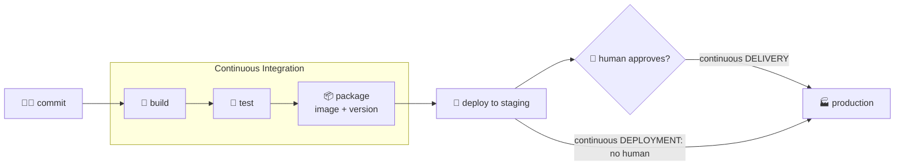
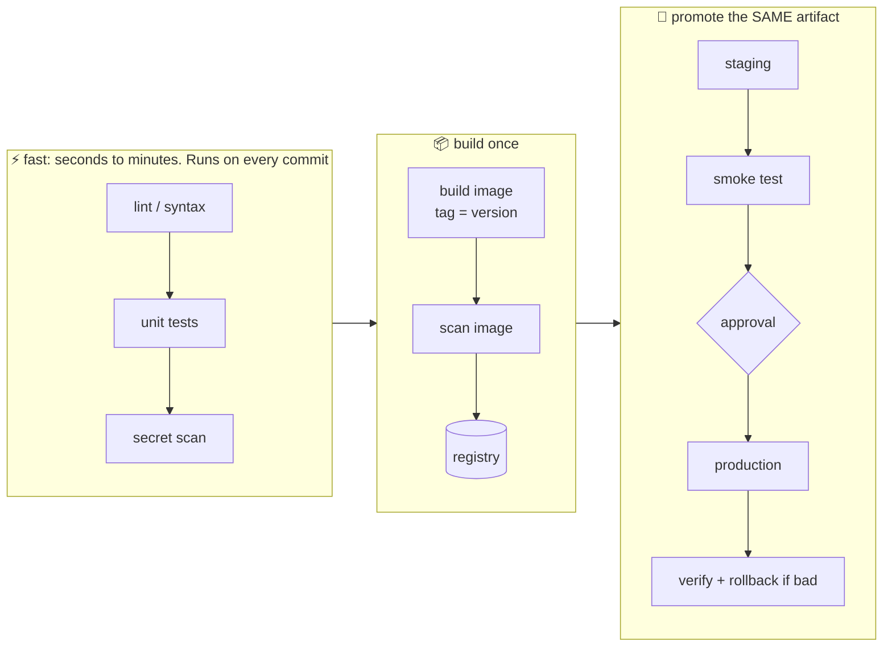
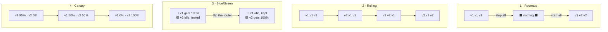
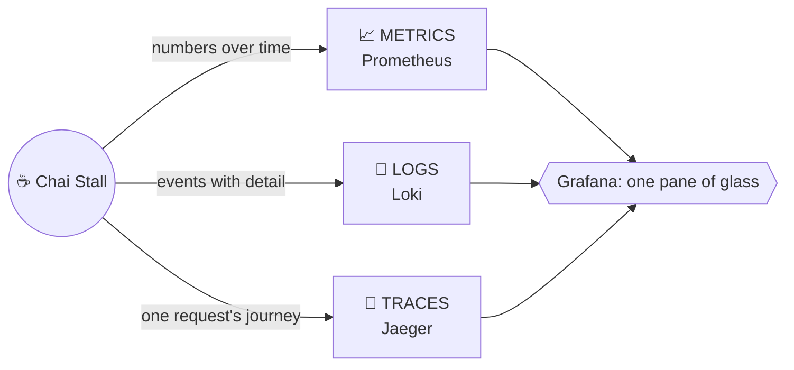
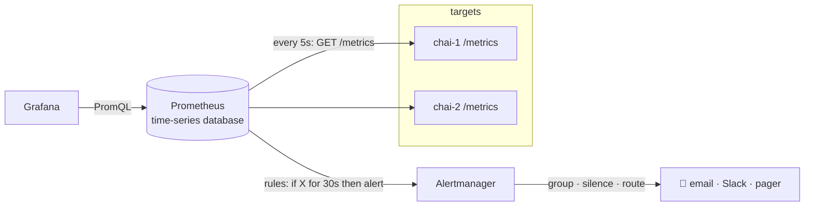
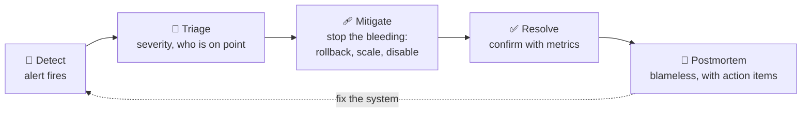
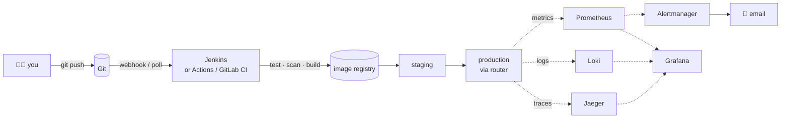

# Lab C00: Foundations: Why Pipelines, Why Observability

> ⏱ 90 min · 🟢 Beginner · Needs: nothing installed. Read it with a coffee, then take the [quiz](quiz.md).
>
> Every later lab starts with "the concept in 60 seconds". This lab is the long version of all of them, in one place, so that the commands in C01 to C09 are never magic.

## 🎯 What you'll learn
- The problem CI/CD solves, and the difference between **CI**, **continuous delivery** and **continuous deployment**
- How to **design a pipeline**: stages, gates, fast feedback, and what belongs where
- The four **deployment strategies**, and how to pick one
- **Monitoring vs observability**, and the three pillars: **metrics, logs, traces**
- **SLIs, SLOs, SLAs** and the **error budget**, with the arithmetic
- The shape of **incident response**, and why postmortems are blameless

---

## 1. The problem: "it works on my laptop"

Imagine a tea stall with five people changing the menu board at the same time. One writes "Chai ₹10", another "Chai ₹100", a third erases the whole board to "tidy up". Nobody knows which version customers saw, or who changed what, or whether the board even reads correctly.

Software teams had exactly this problem, and a worse one: **integration hell**. Five developers work for weeks on separate copies; the day they combine their work nothing fits, and nobody can say which change broke it.

| Before | After CI/CD |
|---|---|
| Merge once a month, pray | Merge many times a day, in small pieces |
| "Did anyone run the tests?" | A machine runs them on **every** change, the same way every time |
| Deploy = a Friday-night checklist of 40 manual steps | Deploy = one automated, repeatable, boring command |
| Bug found by a customer a week later | Bug found by a robot in 4 minutes |
| "Who deployed that?" | Every release traces back to one commit |

## 2. CI, CD and CD

| Term | Meaning | Question it answers |
|---|---|---|
| **Continuous Integration (CI)** | every change is merged to the shared branch often, then **built and tested automatically** | "Does the code still work when combined?" |
| **Continuous Delivery** | every change that passes is **always ready** to release; a human presses the final button | "Could we ship this right now?" |
| **Continuous Deployment** | every change that passes is **released automatically**, no button | "Does shipping need a human at all?" |

Most real teams do continuous *delivery* to production (a button, or an approval) and continuous *deployment* to staging. You will do exactly that in [Project 1](../projects/project-1-ship-it/README.md).

## 3. Designing a pipeline

A pipeline is a **conveyor belt with quality inspectors**. Each station (stage) checks one thing; a failure stops the belt, so a defect never reaches the next station.

**The design rules that matter** (each one is a mistake someone has paid for):

1. **Fail fast.** Cheap, quick checks first (syntax, unit tests, secret scan). Slow ones (image scan, integration tests) later. A developer waiting 20 minutes to learn about a typo will stop trusting the pipeline.
2. **Build once, promote the same artifact.** Do not rebuild for production. The image tested in staging is byte-for-byte the image that goes to production (you will compare **digests** in [C04](../C04-artifacts-secrets-security/README.md)). Rebuilding can pick up a different dependency version and ship something nobody tested.
3. **The pipeline is code.** Its definition lives in Git next to the application (`Jenkinsfile`, `.github/workflows/*.yml`, `.gitlab-ci.yml`), is reviewed in pull requests, and has history. A pipeline configured by clicking in a web page cannot be reviewed, copied, or recovered.
4. **Every stage has one job and a clear pass/fail.** "Build and test and deploy" in one shell script is not a pipeline.
5. **Gates, not suggestions.** A failing test, a leaked secret or a critical vulnerability must stop the belt. A check everyone ignores is worse than no check.
6. **Environments are the same shape.** Staging should differ from production in size, not in kind.
7. **Make rollback as easy as deploy.** If going back needs a meeting, you will not do it when you should.
8. **Secrets never live in Git or in logs.** Injected at run time, scoped to one job ([C04](../C04-artifacts-secrets-security/README.md)).
9. **Keep the main branch always releasable.** Short-lived branches, small pull requests, tests before merge (*trunk-based development*).

### The four pieces every CI system has

| Piece | Jenkins | GitHub Actions | GitLab CI |
|---|---|---|---|
| The brain that schedules work | **controller** | GitHub itself | GitLab itself |
| The machine that runs a job | **agent / executor** | **runner** | **runner** |
| The unit of work | **stage** → **step** | **job** → **step** | **job** (in a **stage**) |
| The pipeline file | `Jenkinsfile` | `.github/workflows/*.yml` | `.gitlab-ci.yml` |
| What starts it | webhook, poll, button | `on:` events | `rules:` / events |

## 4. Deployment strategies

How do you replace version 1 with version 2 without the customers noticing? Four classic answers:

| Strategy | Downtime | Extra capacity | Rollback | Best for | Risk |
|---|---|---|---|---|---|
| **Recreate** | yes | none | redeploy old | dev/staging, apps that cannot run two versions at once | outage during switch |
| **Rolling** | no | a little | roll forward/back one by one (slow) | most stateless services (Kubernetes default) | two versions run together for a while |
| **Blue/Green** | no | **double** | **instant** (flip back) | big, risky changes; databases with care | cost; both versions must be tested |
| **Canary** | no | a little | instant (set weight to 0) | verifying with **real traffic** before everyone gets it | needs good metrics to judge "healthy" |

All four are **live in this track**: [`deploy.sh`](../projects/project-1-ship-it/deploy/deploy.sh) implements them with nothing but Docker and nginx, so you can watch each one in a terminal ([C05](../C05-images-and-deployment/README.md)). Kubernetes does rolling by default ([K06](../../kubernetes/06-rollouts/README.md)) and canary with the Gateway API ([K12](../../kubernetes/12-gateway-ingress/README.md)).

**Feature flags** are the fifth tool: deploy the code dark, then turn the feature on for 1% of users. Deployment (code reaches servers) and release (users see it) become separate decisions.

## 5. Monitoring vs observability

- **Monitoring** answers questions you **knew to ask**: "Is the CPU above 90%? Is the site up?" You decide the dashboards and alerts in advance.
- **Observability** is the ability to answer questions you **did not know to ask**, from the data your system already emits: "Why are orders slow, but only for coffee, only on instance 2, only since 14:05?"

A system is observable if you can understand its inside from its outside. You get there with three kinds of telemetry, the **three pillars**:

| Pillar | What it is | Strength | Weakness | Question |
|---|---|---|---|---|
| **Metrics** | numbers sampled over time (`orders_total`, latency histogram) | cheap, fast, great for alerts and trends | no detail about *which* request | "**Is** something wrong? How bad? Since when?" |
| **Logs** | timestamped records of events (`{"level":"error","path":"/order"}`) | rich detail, great for the *why* | big, slow to search without an index | "**What** happened in this failure?" |
| **Traces** | one request's path through services, as timed **spans** | shows where time is spent across services | needs instrumentation; sampled | "**Where** was this request slow?" |

The pillars are strongest **joined**: a metric alert tells you *something is wrong*, a log line tells you *what*, a trace tells you *where*. The shared key is the **trace_id**, which the Chai Stall puts in every log line and every span ([C08](../C08-logs-and-traces/README.md)).

### What to measure: three recipes
- **The four golden signals** (Google SRE): **latency**, **traffic**, **errors**, **saturation**. Start here for any service.
- **RED** (for request-driven services): **R**ate, **E**rrors, **D**uration.
- **USE** (for resources such as CPU, disk): **U**tilization, **S**aturation, **E**rrors.

### Metric types (Prometheus)
| Type | Goes | Example | You usually query it with |
|---|---|---|---|
| **Counter** | only up (resets on restart) | `http_requests_total` | `rate(...[1m])` |
| **Gauge** | up and down | `http_requests_in_flight` | the value itself |
| **Histogram** | counts of observations in buckets | `http_request_duration_seconds_bucket` | `histogram_quantile(0.95, ...)` |

### How Prometheus works (the pull model)

Prometheus **pulls** (scrapes) each target's `/metrics` page on a schedule. A target that disappears shows up as `up == 0`: a free "is it alive?" check. Alertmanager is separate on purpose: Prometheus *decides* an alert is firing; Alertmanager decides *who hears about it, how, and how often* (grouping, silences, inhibition).

## 6. SLIs, SLOs and SLAs

Three words that are easy to mix up. Think of a delivery service:

| Term | Plain meaning | Chai Stall example |
|---|---|---|
| **SLI** (indicator) | a **measurement** of how things are going | the share of orders that succeed |
| **SLO** (objective) | the **target** you set for that measurement, for yourselves | "99% of orders succeed, over 30 days" |
| **SLA** (agreement) | a **contract** with customers, with **consequences** (refunds) if missed | "99% or you get 10% credit" |

SLOs are **tighter** than SLAs on purpose: you want to notice and fix problems *before* you owe anyone money.

**Good SLIs** measure what users feel: availability (did the request succeed?), latency (was it fast enough?), correctness, freshness. CPU is *not* an SLI; nobody cares about your CPU, they care that their chai order worked.

### The error budget: the arithmetic

If the SLO is **99.9%**, you are *allowed* to fail 0.1% of the time. That allowance is the **error budget**.

| SLO | Allowed failure | Downtime per 30 days | Per year |
|---|---|---|---|
| 99% | 1% | 7 h 12 min | 3.65 days |
| 99.9% | 0.1% | **43 min 12 s** | 8.77 h |
| 99.99% | 0.01% | 4 min 19 s | 52.6 min |
| 99.999% | 0.001% | 26 s | 5.3 min |

Each extra "nine" costs roughly ten times more engineering. The budget turns arguments into arithmetic: budget left → ship features faster; budget burned → freeze risky releases and fix reliability. Reliability stops being a feeling.

**Burn rate** is how fast you are spending the budget. A burn rate of 1 uses exactly the whole budget in the 30 days. A burn rate of 14.4 would use it in 2 days (30 ÷ 14.4). So you alert on **fast burn** (page now: a big, sudden problem) and **slow burn** (ticket: a slow leak), each measured over two windows so a blip does not wake anyone. You will build both in [C09](../C09-slo-incident-response/README.md).

## 7. Incident response

An **incident** is an unplanned event that hurts users (or is about to). The goal is not to find the culprit; it is to **restore service quickly**, then learn.

Roles for anything bigger than a one-person problem: an **incident commander** (coordinates, decides), a **ops lead** (hands on keyboard), a **communications lead** (updates stakeholders). In a two-person team one person can wear two hats; never all three.

| Severity | Meaning | Example | Response |
|---|---|---|---|
| **SEV1** | most users cannot use the service | orders fail for everyone | page now, all hands |
| **SEV2** | a big feature or a subset of users is broken | one instance down, 30% of orders fail | page the on-call |
| **SEV3** | minor, workaround exists | dashboard slow | ticket, next business day |

**Mitigate first, diagnose later.** If a release caused the problem, the fastest fix is almost always a rollback, not a clever patch.

**Blameless postmortems.** People did the reasonable thing with the information they had; the *system* allowed the mistake. A good postmortem has: a timeline, impact (how many users, how long, how much budget burned), the root cause(s), what went well, what went badly, and **action items with owners and dates**. You get a template in [Project 2](../projects/project-2-see-everything/docs/postmortem-template.md).

**Runbooks** are the on-call engineer's recipe card for a specific alert: *what does this mean, how do I check, how do I fix, who do I call*. An alert without a runbook is an alarm without an exit sign. Every alert in this track links to [one](../projects/project-2-see-everything/docs/runbook.md).

## 8. How this track maps onto the tools

The solid arrows are [Project 1](../projects/project-1-ship-it/README.md); the dotted ones are [Project 2](../projects/project-2-see-everything/README.md). In Phase 7 of Project 2 they connect: you ship a bad canary with Project 1's pipeline and watch it appear on Project 2's dashboard.

## 🏆 Challenge
Your SLO is 99.9% of orders succeed over 30 days. The stall handles about 100,000 orders a month. (a) How many failed orders are in the budget? (b) A bad release fails 2% of orders for 3 hours at the stall's normal rate of ~140 orders/hour. How much of the budget is gone?

Check your answer

(a) 0.1% of 100,000 = **100 failed orders** for the month.
(b) 3 hours × 140 orders/hour = 420 orders; 2% of 420 = **about 8 failed orders**, so **8% of the budget**. That is a small, recoverable hit, which is exactly why the SLO is not "zero failures ever". A bad release that fails 50% of orders for 3 hours is 210 failures: **more than the entire monthly budget** (210%) in one afternoon. That second picture is what the fast-burn alert in C09 is built to catch in minutes, not hours.

## ✅ Take the quiz
[**Quiz: 30 questions with hidden answers →**](quiz.md) Do it before C01. Come back to it after C09 and see how many answers you would now change.

➡️ Next: [C01 · Git-based CI: GitHub Actions and GitLab CI](../C01-git-based-ci/README.md)
