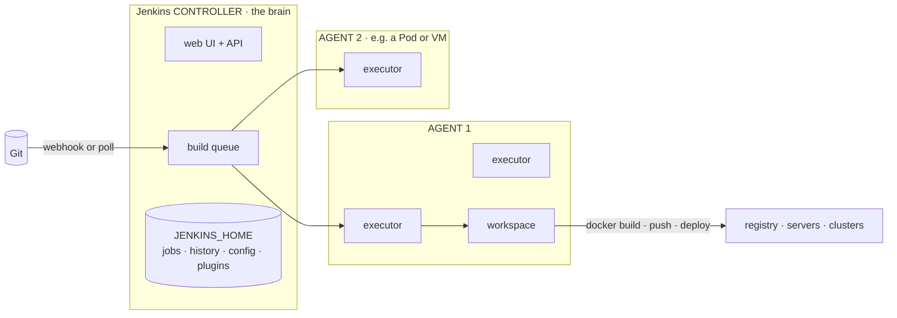

# Lab C02: Jenkins Architecture and Pipeline as Code

> ⏱ 75 min · 🟡 Intermediate · Needs: [C00](../C00-foundations/README.md), Docker + Compose, about 2 GB of free memory, ports 8080, 5001, 8090.

## 🎯 What you'll learn
- Jenkins' architecture: **controller**, **agents**, **executors**, **workspace**, **plugins**, **`JENKINS_HOME`**
- **Jenkins Configuration as Code**: a whole Jenkins from one YAML file, no clicking
- **Pipeline as Code**: the anatomy of a `Jenkinsfile` (declarative), parameters, parallel stages, approval gates, `post`
- Declarative vs scripted pipelines, multibranch pipelines and shared libraries
- Triggers: webhook vs polling

## 🧠 Concept in 60 seconds



- The **controller** holds the configuration and history, serves the UI and API, and **schedules** work. It should do almost no building itself.
- An **agent** is a machine (VM, container, Kubernetes Pod) that connects to the controller and runs the work. An **executor** is one slot on an agent that can run one build at a time.
- A build gets a **workspace**: a private folder where the code is checked out.
- Everything specific (Git, Docker, pipelines, credentials) is a **plugin**. Jenkins is a small core plus ~1,800 plugins; that is its strength and its maintenance burden.
- All state lives in **`JENKINS_HOME`**. Lose it, lose Jenkins, unless your configuration is *code* (Step 3).

In this lab the controller runs in one container and builds on its own built-in executors (2 slots). That is the simplest setup that teaches the model; [K20](../../kubernetes/20-projects/README.md) shows the production-style version where every build gets a fresh Pod as its agent.

## 🧪 Hands-on

### Step 1: Start the factory (about 4 minutes the first time)
```bash
cd cicd-observability/projects/project-1-ship-it
git switch -c practice                    # a private practice branch: nothing you commit here can touch the shared repo
cp .env.example .env
sed -i.bak "s#^REPO_BRANCH=.*#REPO_BRANCH=*/$(git branch --show-current)#" .env && rm .env.bak
grep REPO_BRANCH .env                     # REPO_BRANCH=*/practice
docker compose up -d --build
docker compose ps
```
`REPO_BRANCH` tells Jenkins which Git branch to build. **Jenkins builds a branch of Git, not your working folder, and you never need to `git push`**: it reads your local repository directly. Commit on the branch it watches (the reason is Step 7). If you ever change branch, run `./scripts/use-branch.sh` from this folder and Jenkins follows.

The first build downloads Jenkins and installs about a dozen plugins into the image (3 to 5 minutes). Watch it become ready:
```bash
docker compose logs -f jenkins | grep -m1 "fully up and running"        # Ctrl+C if it does not return
```
Open **http://localhost:8080**, log in with `admin` / `z2h-jenkins`. There is **no setup wizard**: it was configured from a file. Which brings us to...

> **Behind a company proxy?** If the image build fails with `PKIX path building failed`, put your proxy's root certificate in [`jenkins/extra-ca/`](../projects/project-1-ship-it/jenkins/extra-ca/README.md) and build again.

### Step 2: Look inside the controller (10 min)
```bash
docker exec shipit-jenkins-1 ls /var/jenkins_home                  # JENKINS_HOME: jobs/, plugins/, workspace/, secrets/ ...
docker exec shipit-jenkins-1 ls /var/jenkins_home/plugins | head   # the plugins, one folder each
docker exec shipit-jenkins-1 sh -c 'ls /var/jenkins_home/workspace' # where builds check out code (empty until you build)
```
In the UI:
1. **Manage Jenkins → Nodes**: one node, **Built-In Node**, with **2 executors**. (Can two builds run at once? Yes. A third waits in the **queue**.)
2. **Manage Jenkins → Plugins → Installed plugins**: find *Pipeline*, *Git*, *Job DSL*, *Configuration as Code*, *Credentials Binding*.
3. **Manage Jenkins → System**: scroll to **Configuration as Code**; the page you are on was produced by a file.

### Step 3: Configuration as Code: Jenkins from a file (10 min)
Open [`jenkins/casc/jenkins.yaml`](../projects/project-1-ship-it/jenkins/casc/jenkins.yaml). Read it top to bottom; it has five blocks:

| Block | What it configures | The lesson |
|---|---|---|
| `jenkins.securityRealm` + `authorizationStrategy` | who can log in and what they may do | access control is *configuration*, so it is reviewed |
| `unclassified` | global settings (admin email, URL) | no "Manage Jenkins" clicking |
| `security.globalJobDslSecurityConfiguration` | lab-only switch so our seed job can run | note the comment: a *deliberate*, documented exception |
| `credentials` | two credentials, whose **values come from environment variables** (`${DEPLOY_TOKEN}`) | the secret is **not in Git**; it is in `.env`, which is git-ignored |
| `jobs` | one hand-made job, the **seed** | everything else is generated from Git (C03) |

Prove it is real: change a setting **in the file** and watch Jenkins follow.
```bash
sed -i.bak 's/Unit 4 lab Jenkins/Unit 4 lab Jenkins (edited by me)/' jenkins/casc/jenkins.yaml && rm jenkins/casc/jenkins.yaml.bak
docker compose up -d --build jenkins
```
Refresh http://localhost:8080 after about a minute: the banner at the top of the dashboard changed. Revert it with `git checkout jenkins/casc/jenkins.yaml`.

**Why this matters.** Destroy Jenkins completely (`docker compose down -v`, which deletes the volume) and `docker compose up -d` gives you back the *same* Jenkins with the same jobs. A server you can rebuild from Git is a server you do not have to be afraid of. (The config is baked into the image **outside** `JENKINS_HOME` on purpose: a persistent volume would otherwise keep an old copy and hide your changes.)

### Step 4: Let the seed job create the jobs (3 min)
In the UI open the job **00-seed → Build Now**, then click the build number → **Console Output**. At the end you will see `GeneratedJob{name='chai-stall/ci-cd'}` and friends. Go back to the dashboard: a **chai-stall** folder now exists with the pipelines inside. (How, exactly, is [C03](../C03-job-dsl-dynamic/README.md).)

### Step 5: Read the Jenkinsfile (15 min)
Open [`Jenkinsfile`](../projects/project-1-ship-it/Jenkinsfile). The file *is* the pipeline: Jenkins loads it from Git on every build, so the pipeline changes with the code, in the same pull request.

```groovy
pipeline {                      // 1  declarative pipeline: a strict, validated structure
  agent any                     // 2  where to run: any available executor
  options { ... }               // 3  timeouts, timestamps, "never run two at once", log retention
  parameters { ... }            // 4  becomes the "Build with Parameters" form
  environment { ... }           // 5  variables for every step (and credentials, see C04)
  stages {                      // 6  the conveyor belt
    stage('Test') { steps { ... } }
    stage('Checks in parallel') { parallel { ... } }
    stage('Approval') { when { ... } steps { input ... } }
  }
  post { success {...} failure {...} always {...} }   // 7  runs after the stages, whatever happened
}
```
Walk the actual file with this checklist (tick each as you find it):

- [ ] `disableConcurrentBuilds()`: why? *(two deploys at once would fight over the same containers)*
- [ ] `parameters { choice(name: 'STRATEGY' ...) }`: where will this show up in the UI?
- [ ] `environment { VERSION = "1.0.${env.BUILD_NUMBER}" }`: how does each build get a unique version?
- [ ] `stage('Checks in parallel') { parallel { ... } }`: two stages run side by side
- [ ] `when { expression { params.SCAN_MODE != 'skip' } }`: a stage that can be skipped by a parameter
- [ ] `withCredentials([usernamePassword(...)])`: a secret that exists only inside this block (C04)
- [ ] `input message: ... ok: 'Ship it'`: the pipeline **pauses for a human**
- [ ] `script { if (params.STRATEGY == ...) }`: an escape hatch into plain Groovy for logic that declarative syntax cannot express
- [ ] `post { always { ... } }`: cleanup that runs even on failure

### Step 6: Run it for the first time (10 min)
Open **chai-stall → ci-cd**. Click **Build Now**.

> 💡 **Jenkins quirk worth knowing:** parameters are *declared in the Jenkinsfile*, so Jenkins only learns them after reading the file once. The **first** build therefore runs with defaults and shows no form; from the second build on, the button says **Build with Parameters**.

The first build uses the defaults (`bluegreen`, scan on, approval on), so it will march through the stages and **stop at Approval** (or fail at "Scan image", see below). Open the build and click **Console Output**, or use the stage view.

If it stops at **Approval**: click the *Ship it* prompt (in the build's page, the yellow "Input requested" box), then watch **Release to production** run. Verify:
```bash
curl -s localhost:8081/api/info        # staging
curl -s localhost:8090/api/info        # production, through the router
```
Both answer with `"version": "1.0.1"` (or whatever the build number was).

> ⚠️ **If "Scan image" fails** with a message about downloading the vulnerability database, the scanner could not reach the internet (offline lab, corporate proxy). That is the gate **failing closed**, which is correct. Run **Build with Parameters** and set `SCAN_MODE` to `report` (scan and show, do not fail) or `skip`. We explore this stage in [C04](../C04-artifacts-secrets-security/README.md).

Now run it again with **Build with Parameters**, `REQUIRE_APPROVAL` unticked: the whole pipeline goes through without stopping. That is the difference between continuous *delivery* and *deployment* you read about in C00.

### Step 7: Triggers: how a commit starts a build (10 min)
Jenkins can start a build two ways:
- **Webhook (push):** Git calls Jenkins the moment you push. Instant, but needs Jenkins reachable from the internet (or a tunnel).
- **Polling (pull):** Jenkins asks Git "anything new?" on a schedule. Slower, works anywhere. The job uses this: `triggers { scm('H/2 * * * *') }` in [`pipelines.groovy`](../projects/project-1-ship-it/jenkins/jobs/pipelines.groovy) (`H` spreads the load: "about every 2 minutes").

Try it. Make a change, commit it **on the branch Jenkins watches** (`git branch --show-current` must match `REPO_BRANCH` in `.env`; if not, run `./scripts/use-branch.sh`), and do nothing else. (A commit needs `git config user.name` and `user.email` once; it needs no GitHub login and nothing is pushed.)
```bash
cd ../../..                                             # repo root
sed -i.bak 's/"biscuit": 5/"biscuit": 6/' cicd-observability/app/app.py && rm cicd-observability/app/app.py.bak
git commit -am "price of a biscuit goes up by one rupee"
```
Within ~2 minutes a new build starts **on its own**, because a new commit appeared. It passes (no test checks the biscuit price yet; adding one is a task in [Project 1](../projects/project-1-ship-it/README.md)) and, with the default parameters, waits at **Approval**. The polling log is under the job's **Git Polling Log**.

### Step 8: Declarative vs scripted; multibranch; shared libraries (reading)
**Scripted pipeline** (the older style) is plain Groovy; maximum freedom, no guard rails:
```groovy
node {                                    // no "pipeline {}" wrapper
  stage('Test') { sh 'python3 -m unittest' }
  if (env.BRANCH_NAME == 'main') {        // any Groovy is allowed anywhere
    stage('Deploy') { sh './deploy.sh' }
  }
}
```
Prefer **declarative** for readability and early syntax checking; use `script { }` blocks for the rare complex bit. [`Jenkinsfile.dynamic`](../projects/project-1-ship-it/Jenkinsfile.dynamic) leans on `script` and is a good example of *when* (C03).

**Multibranch pipeline:** instead of one job, Jenkins scans a repository and creates **one pipeline per branch and per pull request**, each from the Jenkinsfile on that branch. New branch → new pipeline, automatically; deleted branch → pipeline removed. This is how most teams run Jenkins. It needs a Git server Jenkins can list (GitHub, GitLab, Gitea), so we keep the lab simple with a plain pipeline job; the Job DSL for it is `multibranchPipelineJob` and looks very similar to [`pipelines.groovy`](../projects/project-1-ship-it/jenkins/jobs/pipelines.groovy).

**Shared libraries:** when ten repositories each copy-paste the same 80 lines of deploy stages, put them in one Git repository as a *library* and call them: `@Library('company-pipelines') _` then `deployService(name: 'chai-stall', strategy: 'canary')`. One fix, ten pipelines fixed.

## 🏭 In production
- **Never build on the controller.** Give the controller `0` executors and run builds on agents, ideally ephemeral ones (one container or Pod per build, discarded afterwards), so no build can see another's files or leave a mess.
- Keep `JENKINS_HOME` on a **backed-up volume** and the *configuration* in Git (this lab's approach). Pin plugin versions, update on a schedule, and read the security advisories: plugins are the most common way into Jenkins.
- Put Jenkins behind HTTPS and SSO (OIDC/LDAP). This lab's `admin` / fixed password is acceptable only because it is bound to your laptop.
- Use **webhooks**, not polling, and **multibranch** pipelines with the `Jenkinsfile` in each repository.
- Manage Jenkins' own Docker-socket access with great care: see [C04](../C04-artifacts-secrets-security/README.md).

## 🏆 Challenge
Add a **parameter** called `VERSION_SUFFIX` (a string, default empty) so that a build can produce a tag like `1.0.7-rc1`. Where do you change the pipeline, and what *two* things must you remember?

<details><summary>Check your answer</summary>

1. In `parameters { string(name: 'VERSION_SUFFIX', defaultValue: '', description: 'Optional, e.g. -rc1') }`.
2. In `environment`, change `VERSION = "1.0.${env.BUILD_NUMBER}${params.VERSION_SUFFIX}"`. A catch: `params` is not available in `environment` on the very first build (the parameters are not registered yet), so the safe form is `"1.0.${env.BUILD_NUMBER}${params.VERSION_SUFFIX ?: ''}"`.
Two things to remember: (a) commit and push to the branch Jenkins watches, because the pipeline comes from Git; (b) the first build after the change runs with defaults and registers the new parameter, so the form appears from the *next* build. Docker tags may contain letters, digits, `_`, `.` and `-`, so `-rc1` is fine but `+rc1` is not.
</details>

## ✅ Checkpoint
<details><summary>1. Why should the controller have zero executors in production?</summary>

A build runs arbitrary code. If it runs on the controller it can read every job, credential and log. On an agent the blast radius is the agent. Also builds then cannot starve the scheduler.
</details>

<details><summary>2. You delete the <code>jenkins-home</code> volume. What do you lose and what comes back by itself?</summary>

You lose build history, workspaces and any setting made by clicking. Because the configuration (users, credentials, seed job) is in `jenkins.yaml` and the jobs are generated from `jobs/*.groovy` in Git, `docker compose up -d` and one run of the seed job bring the jobs back.
</details>

<details><summary>3. Where does the pipeline definition live, and why is that better than inside Jenkins?</summary>

In a `Jenkinsfile` in the repository. It is reviewed in pull requests, versioned, branch-specific, and survives the loss of the Jenkins server.
</details>

<details><summary>4. While a pipeline waits at <code>input</code>, what does it cost, and how do you limit it?</summary>

With `agent any` at the top, the build holds an executor the whole time a human thinks about it. Real pipelines put the approval in its own stage with `agent none`, so no executor is held, and always wrap it in `timeout` so an abandoned approval does not hang forever (this lab does the `timeout`).
</details>

## 🧹 Cleanup
Keep the stack running for C03 to C05. To stop everything and keep data: `docker compose stop`. To remove all of it: `docker compose down -v` (run `./deploy/deploy.sh clean` first to remove the deployed app containers).

➡️ Next: [C03 · Job DSL and dynamic pipelines](../C03-job-dsl-dynamic/README.md)
