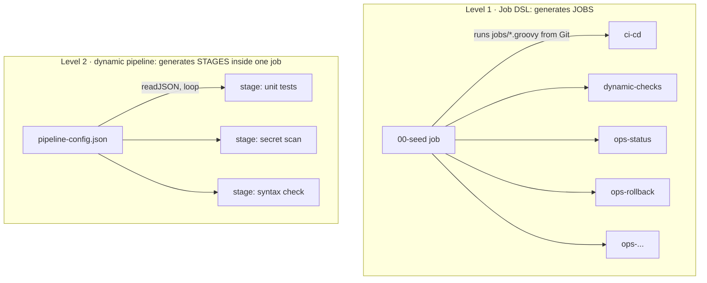

# Lab C03: Job DSL and Dynamic Pipelines

> ⏱ 45 min · 🟡 Intermediate · Needs: [C02](../C02-jenkins-pipelines/README.md) done and the Project 1 stack running (`docker compose ps` shows `jenkins`, `registry`, `router`).

## 🎯 What you'll learn
- Why "jobs created by clicking" does not scale, and what a **seed job** is
- Write Jenkins **jobs as code** with the **Job DSL** (folders, pipeline jobs, freestyle jobs, parameters, views)
- Generate **many jobs from one loop**
- Build a **dynamic pipeline**: stages created at run time from data
- Know when *not* to be dynamic

## 🧠 Concept in 60 seconds

C02's `Jenkinsfile` defines what **one** pipeline does. But a team has *dozens* of jobs: one per service, per environment, plus operations buttons. Creating them by clicking is slow, error-prone, and unrepeatable. Two tools fix that, at two different levels:



| | **Job DSL** | **Dynamic pipeline** |
|---|---|---|
| Generates | Jenkins **jobs** (and folders, views) | **stages** inside one pipeline run |
| When it runs | when you run the seed job | every time the pipeline runs |
| Input | Groovy script | any data: JSON, a list, `git diff`, an API |
| Use for | "one job per service / environment", ops buttons | "one stage per changed folder / region / Python version" |

## 🧪 Hands-on

### Step 1: Read the three job files (8 min)
They are in [`jenkins/jobs/`](../projects/project-1-ship-it/jenkins/jobs/). The seed job runs them **in alphabetical order**: `base`, `deploy_jobs`, `pipelines`. (Names may contain letters, digits and underscores only: that is why `deploy_jobs.groovy` has an underscore, and why the folder is created in `base.groovy`, which sorts first.)

**[`base.groovy`](../projects/project-1-ship-it/jenkins/jobs/base.groovy)**: four lines, one folder:
```groovy
folder('chai-stall') { description('...') }
```

**[`pipelines.groovy`](../projects/project-1-ship-it/jenkins/jobs/pipelines.groovy)**: a **closure** (a reusable recipe) that creates a pipeline job whose steps come from a `Jenkinsfile` in Git, called twice:
```groovy
def pipelineFromGit = { String jobName, String file, String desc, boolean poll -> pipelineJob("chai-stall/${jobName}") { ... } }
pipelineFromGit('ci-cd',         'Jenkinsfile',         '...', true)
pipelineFromGit('dynamic-checks','Jenkinsfile.dynamic', '...', false)
```
Notice the repository and branch are read from the **environment** (`System.getenv('REPO_URL')`): the same file works for your laptop and for a GitHub URL.

**[`deploy_jobs.groovy`](../projects/project-1-ship-it/jenkins/jobs/deploy_jobs.groovy)**: a **loop**: four jobs from one list.
```groovy
['status', 'rollback', 'promote', 'clean'].each { action ->
  job("chai-stall/ops-${action}") { steps { shell("${deployScript} ${action}") } }
}
```
…plus one **parameterised** job (`ops-canary-any-tag`) and a **view** that gathers them.

### Step 2: Use the generated buttons (5 min)
Open the **chai-stall** folder → the **Operations** view. These jobs are the on-call engineer's buttons: no SSH, no remembering commands, an audit trail of who pressed what.

Run **ops-status**, then open its **Console Output**. You will see the router state and the running containers. If you have already run the pipeline, you see `chai-blue` / `chai-green`.

### Step 3: Add a job by changing code (10 min)
Add one more button, `state`, by editing **one word**. From the repository root:
```bash
sed -i.bak "s/\['status', 'rollback', 'promote', 'clean'\]/['status', 'rollback', 'promote', 'clean', 'state']/" \
  cicd-observability/projects/project-1-ship-it/jenkins/jobs/deploy_jobs.groovy
rm cicd-observability/projects/project-1-ship-it/jenkins/jobs/deploy_jobs.groovy.bak
git diff --stat
```
Run the seed job now (**00-seed → Build Now**). Check the Operations view. **Nothing changed.** Why?

<details><summary>Think first, then open</summary>

The seed job reads the files from **Git** (the *committed* branch), not from your working folder. You have not committed yet. This is the single most common surprise with pipelines-as-code: **if it is not committed, Jenkins cannot see it.**
</details>

Commit, then run the seed again:
```bash
git commit -am "add the ops-state button"
```
**00-seed → Build Now**. After ~20 seconds, **ops-state** appears in the Operations view. You just created a Jenkins job with a one-word code change and a commit.

Now **delete** it the same way: remove `, 'state'` from the list, commit, run the seed. The job disappears. That is the `removeAction('DELETE')` line in [`jenkins.yaml`](../projects/project-1-ship-it/jenkins/casc/jenkins.yaml): jobs the seed created but no longer describes are cleaned up, so Jenkins always matches Git. (Undo your experiment's commits with `git reset --hard HEAD~2` if you want your branch tidy: only do this if your last two commits are the two you just made.)

### Step 4: A job that asks a question (5 min)
Run **ops-canary-any-tag** (Build with Parameters). It needs a tag that exists. List what the registry holds, from the artifact store you built in C02:
```bash
curl -s localhost:5001/v2/chai-stall/tags/list
```
Pick one, for example `1.0.1`, set `PERCENT=30`. The job calls `deploy.sh canary` with a tag *already in the registry*. Then press **ops-rollback**. Notice what you did **not** have to do: rebuild anything. Releasing an old version is just pointing at an existing artifact.

> The Job DSL has a snippet generator: **Manage Jenkins → ... → Job DSL API Reference** (`http://localhost:8080/plugin/job-dsl/api-viewer/index.html`) lists every method for every installed plugin. When you want to automate something you know how to click, look for it there.

### Step 5: A dynamic pipeline (12 min)
Open [`Jenkinsfile.dynamic`](../projects/project-1-ship-it/Jenkinsfile.dynamic) and [`pipeline-config.json`](../projects/project-1-ship-it/pipeline-config.json). The Jenkinsfile contains **no checks at all**; the JSON does:
```json
{ "checks": [
    { "name": "unit tests",   "cmd": "cd cicd-observability/app && python3 -m unittest discover -s tests" },
    { "name": "secret scan",  "cmd": ".../secret-scan.sh cicd-observability/app" },
    { "name": "syntax check", "cmd": "python3 -m py_compile cicd-observability/app/app.py" } ] }
```
The pipeline turns each entry into a parallel branch at run time:
```groovy
def cfg = readJSON file: '.../pipeline-config.json'
checks = [:]                                             // a map: name -> closure
cfg.checks.each { c -> checks[c.name] = { stage(c.name) { sh c.cmd } } }
...
parallel checks                                          // run them all side by side
```
Run **chai-stall → dynamic-checks → Build Now**, and look at the stage view: three parallel stages, none of which is written in the Jenkinsfile.

Now add a fourth **by editing data only**:
```bash
python3 - <<'EOF'
import json
p = 'cicd-observability/projects/project-1-ship-it/pipeline-config.json'
d = json.load(open(p))
d['checks'].append({"name": "dockerfile exists", "cmd": "test -f cicd-observability/app/Dockerfile"})
json.dump(d, open(p, 'w'), indent=2)
EOF
git commit -am "dynamic: add a dockerfile check"
```
Run **dynamic-checks** again: **4 parallel stages**, and the report says `All 4 configured checks passed.` No Groovy touched.

> 🔓 **A word of caution.** `sh c.cmd` runs whatever string is in the JSON. That is fine when the file is in your own reviewed repository; it would be a **command-injection hole** if the string came from user input or an untrusted pull request. Dynamic means *powerful*; treat the data as code.

### Step 6: The same idea in GitLab CI (reading, 3 min)
Open [`ci-examples/gitlab-dynamic.yml`](../ci-examples/gitlab-dynamic.yml). One job writes a `child.yml`; the next one runs it with `trigger: include: artifact`. Same pattern (data → generated pipeline), different tool. GitHub Actions does it with a `matrix` built from a JSON output: `matrix: ${{ fromJSON(needs.plan.outputs.matrix) }}`.

## 🏭 In production
- Use the **seed job pattern** for *everything* a team owns; nobody clicks "New Item". Run the seed on every change (a webhook on the repo that holds `jobs/`).
- Dynamic pipelines shine in **monorepos** ("test only the services whose folders changed") and for **matrix** builds (OS × version × region). They hurt readability when overused: a pipeline whose shape nobody can predict from reading it is hard to debug. Rule of thumb: *generate the repetitive part, write the important part by hand.*
- Generated jobs should be **read-only** in the UI in practice: if someone edits one by hand, the next seed run silently overwrites it. Put that in your team's rules.

## 🏆 Challenge
Write a Job DSL loop that creates **three deploy jobs**, `deploy-staging`, `deploy-canary`, `deploy-bluegreen`, each running the matching `deploy.sh` command with the parameter `TAG`. Which one line in the loop makes the *job name* different per iteration, and which makes the *command* different?

<details><summary>Check your answer</summary>

```groovy
[staging: 'staging', canary: 'canary', bluegreen: 'bluegreen'].each { name, strategy ->
  job("chai-stall/deploy-${name}") {                       // <- job name changes
    parameters { stringParam('TAG', '', 'An image tag from the registry') }
    steps { shell("/repo/cicd-observability/projects/project-1-ship-it/deploy/deploy.sh ${strategy} localhost:5001/chai-stall:\$TAG") }   // <- command changes
  }
}
```
`\$TAG` is escaped so Groovy passes the literal `$TAG` to the shell, which reads Jenkins' parameter. Without the backslash Groovy would try to substitute it while generating the job.
</details>

## ✅ Checkpoint
<details><summary>1. You edited <code>deploy_jobs.groovy</code> and ran the seed, but no new job appeared. What is the most likely cause?</summary>

You did not **commit** (or the branch Jenkins watches is not the branch you committed on). The seed job reads from Git.
</details>

<details><summary>2. Job DSL vs a dynamic pipeline: which would you use for "one job per microservice"? Which for "one test stage per changed folder"?</summary>

Job DSL for the first (the unit being generated is a *job*). A dynamic pipeline for the second (the unit is a *stage inside one run*, decided at run time from the diff).
</details>

<details><summary>3. What does <code>removeAction('DELETE')</code> protect you from?</summary>

Drift. Jobs you removed from code would otherwise stay in Jenkins forever, and the list of jobs would no longer match Git.
</details>

## 🧹 Cleanup
Nothing to clean: the generated jobs are part of the running stack. Reset your experiments with `git status` and `git checkout -- <file>`.

➡️ Next: [C04 · Artifacts, secrets and pipeline security](../C04-artifacts-secrets-security/README.md)
