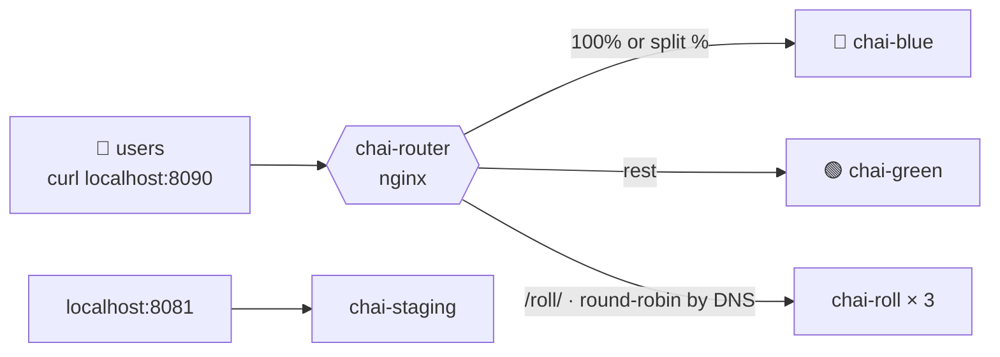

# Lab C05: Container Image Builds and Deployment Strategies

> ⏱ 75 min · 🟡 Intermediate · Needs: the Project 1 stack running ([C02](../C02-jenkins-pipelines/README.md)). You run everything below from your **terminal**; the pipeline version is at the end.
>
> Open two terminals: one for commands, one running `watch -n1 'docker ps --filter label=shipit=1 --format "{{.Names}}\t{{.Image}}\t{{.Status}}"'` (or just run the `deploy.sh status` command when you want to look).

## 🎯 What you'll learn
- How to build a **good image in CI**: layer caching, version stamping, non-root, health check, small
- **Four deployment strategies**, each done for real and measured: **recreate, rolling, blue/green, canary**
- How to tell whether users **noticed** a deployment (and count the failures)
- **Automated canary analysis** and automatic **rollback**

## 🧠 Concept in 60 seconds


Production traffic enters through **one front door** (an nginx container). Changing *which* backend gets traffic, and *how much*, is just changing that door's config and reloading it: no downtime for the router itself. That single idea implements blue/green (flip 100%) and canary (send 10%). It is what a Kubernetes Service, Ingress or Gateway does in a cluster ([K12](../../kubernetes/12-gateway-ingress/README.md)).

## 🧪 Hands-on

### Step 1: Build a good image (10 min)
Open [`app/Dockerfile`](../app/Dockerfile). Each line earns its place:

| Line | Why |
|---|---|
| `FROM python:3.12-alpine` | small base (~50 MB), pinned to a minor version (never `latest`) |
| `ARG APP_VERSION` / `ENV APP_VERSION` | CI **stamps the version** into the image, so `/api/info` and `app_info` tell you exactly what is running |
| `RUN adduser -D -u 10001 app` + `USER 10001` | **non-root** (the image-policy gate checks it) |
| `COPY app.py .` (one file, no dependencies) | nothing to install: fast, tiny attack surface |
| `HEALTHCHECK` | the platform (and `deploy.sh`) can ask "are you actually working?" |
| `CMD ["python", "app.py"]` + a `SIGTERM` handler in `app.py` | **graceful shutdown**: `docker stop` takes less than a second instead of 10 (try it below) |

Build, then look at it:
```bash
cd cicd-observability/app
docker build --build-arg APP_VERSION=demo-0 -t chai-stall:demo-0 .
docker images chai-stall:demo-0
docker history chai-stall:demo-0 | head -8
```
**Layer cache.** Run the identical build again and read the output: every step says `CACHED`, and it takes about a second. A CI server that rebuilds from scratch every time wastes minutes; that is what `cache-from: type=gha` does in the GitHub workflow. Then change the **order**: layers are cached **top to bottom**, and the first changed layer invalidates everything below it. That is why real Dockerfiles `COPY requirements.txt` and install dependencies **before** copying the source: source changes often, dependencies rarely.

**Graceful shutdown:**
```bash
docker run -d --name g chai-stall:demo-0 >/dev/null; sleep 1
time docker stop g; docker rm g >/dev/null
```
It takes well under a second. A process that ignores `SIGTERM` (as PID 1 does by default) makes `docker stop` wait **10 seconds** and then kill it, and drops every request in flight. That matters for rolling updates, next.

> 🔧 **Builders in CI:** `docker build` needs a Docker daemon. In locked-down CI you use **BuildKit** in a container, **Kaniko** (builds from a Dockerfile *without* a daemon, popular in Kubernetes), or **Buildah**. The Dockerfile is identical; only the builder changes.

### Step 2: Make three versions to release (3 min)
```bash
cd ../compose-edition/project-1-ship-it
for v in 1 2 3; do
  docker build -q --build-arg APP_VERSION=demo-$v -t localhost:5001/chai-stall:demo-$v ../../app >/dev/null
  docker push -q localhost:5001/chai-stall:demo-$v >/dev/null
done
curl -s localhost:5001/v2/chai-stall/tags/list
R=localhost:5001/chai-stall           # a shortcut: set it again in every terminal you open
```
You now have `demo-1`, `demo-2`, `demo-3` in the registry. The `deploy.sh` script ([read it](../compose-edition/project-1-ship-it/deploy/deploy.sh), it is about 190 lines of plain bash) is the same one the pipeline calls.

The helper [`traffic-test.sh`](../compose-edition/project-1-ship-it/scripts/traffic-test.sh) sends ~10 requests a second to a URL for N seconds and prints `.` for every success and `x` for every failure. It is how we will **measure whether users noticed**.

### Step 3: Strategy 1: Recreate (staging) (8 min)
Staging uses *recreate*: stop the old, start the new.
```bash
./deploy/deploy.sh staging $R:demo-1
```
Now deploy `demo-2` **while traffic flows**. In one terminal:
```bash
./scripts/traffic-test.sh http://localhost:8081 14
```
and, within 2 seconds, in the other:
```bash
./deploy/deploy.sh staging $R:demo-2
```
Expected: a run of dots, then some **`x`**, then dots again, and `failed=` greater than 0. Both version lines appear in the summary. That gap is the **downtime**: between stopping the old and the new becoming healthy. Fine for staging; not for a stall with a queue.

### Step 4: Strategy 2: Rolling (10 min)
Production's `/roll/` path fronts three replicas that share one DNS name. Roll out `demo-1`, then upgrade to `demo-2` under load:
```bash
./deploy/deploy.sh rolling $R:demo-1
./deploy/deploy.sh status                          # three chai-roll-… containers, all demo-1
```
Terminal A: `./scripts/traffic-test.sh http://localhost:8090/roll 20`
Terminal B (after 2 seconds): `./deploy/deploy.sh rolling $R:demo-2`

Watch B: *for each replica*: **start the new one → wait until it is healthy → smoke test it → stop the old one**. There is always at least as many healthy replicas as before ("surge, then retire", exactly Kubernetes' `maxSurge: 1, maxUnavailable: 0`). The result in A:
```
ok=...  failed=0
versions that answered:
   81 "demo-1"
   32 "demo-2"
```
**Zero failed requests**, and you can see both versions served during the roll: for a while two versions run side by side (so your app must tolerate that, for example a database change must work with both).

### Step 5: Strategy 3: Blue/Green (10 min)
Two full copies, one live. Deploy the new version to the **idle** colour, test it *while it takes no traffic*, then flip.
```bash
./deploy/deploy.sh bluegreen $R:demo-1
./deploy/deploy.sh status
curl -si localhost:8090/api/info | grep -E "X-Slot|version"          # which colour answered, and its version
./deploy/deploy.sh bluegreen $R:demo-2                               # new version goes to the OTHER colour, then the router flips
curl -si localhost:8090/api/info | grep -E "X-Slot|version"
```
`X-Slot` shows the colour; it changed, and so did the version, in one step. Now the regret button:
```bash
./deploy/deploy.sh rollback
curl -s localhost:8090/api/info | grep -o '"version": "[^"]*"'       # back to demo-1, instantly
```
No rebuilding, no redeploying: the old version was **still running and warm**. That is blue/green's superpower, and its cost: you pay for **two** environments while both exist. Measure it under load too (`traffic-test.sh http://localhost:8090 15` while you run `bluegreen`): `failed=0`.

### Step 6: Strategy 4: Canary (12 min)
Send a **small share of real traffic** to the new version first, and judge it by what happens.

**A good canary.** Release `demo-2` to 30% of users:
```bash
./deploy/deploy.sh canary $R:demo-2 30
for i in $(seq 1 20); do curl -s -o /dev/null -D- -X POST localhost:8090/order | tr -d '\r' | awk '/^X-Slot/{print $2}'; done | sort | uniq -c
```
About 6 of 20 requests land on the canary's colour (`split_clients` splits by hash, so it is roughly 30%, not exactly). Now let **a machine judge it**:
```bash
./scripts/canary-check.sh 100 5            # send 100 orders; fail if the canary's error rate is above 5%
echo "exit code: $?"
```
`canary chai-…: 0 failed of 3x requests = 0% (limit 5%)` and exit code `0`: promote it.
```bash
./deploy/deploy.sh promote
```

**A bad canary.** Now release `demo-3`, but pretend it has a bug (a 30% failure rate, injected through the environment: this is the `CHAOS_ERROR_RATE` the app reads at start):
```bash
CHAOS_ERROR_RATE=0.3 ./deploy/deploy.sh canary $R:demo-3 30
./scripts/canary-check.sh 100 5 ; echo "exit code: $?"
```
Expected: something like `canary chai-…: 11 failed of 36 requests = 30% (limit 5%)` and exit code `1`. The **deploy-time smoke test passed** (the version answers `/readyz` and `/api/info`; the bug is only in `/order`), but the traffic analysis caught it. Roll back:
```bash
./deploy/deploy.sh rollback
./scripts/canary-check.sh 10 5             # "no canary is running"
```
> 🤔 **Why does the check look at the canary's own error rate instead of the total?** If 30% of the canary's requests fail but only 30% of users reach the canary, users overall see ~9% errors; at a 5% canary it would be ~1.5%, easily lost in noise. Judge the canary against itself.

### Step 7: Fill in the comparison yourself (5 min)
You have now *felt* all four. Complete this table from memory, then check:

| | Downtime? | Extra capacity? | Rollback speed | Two versions at once? |
|---|---|---|---|---|
| Recreate | | | | |
| Rolling | | | | |
| Blue/Green | | | | |
| Canary | | | | |

<details><summary>Check</summary>

| | Downtime? | Extra capacity? | Rollback speed | Two versions at once? |
|---|---|---|---|---|
| Recreate | **yes** (you saw the `x` run) | none | redeploy the old version (slow) | no |
| Rolling | no | a little (one extra replica) | roll back the same way: slow | **yes**, during the roll |
| Blue/Green | no | **double** | **instant** (flip back) | only briefly if at all |
| Canary | no | a little | instant (weight to 0) | **yes**, by design, for as long as you watch |
</details>

### Step 8: The same, from the pipeline (7 min)
All of this is in the Jenkinsfile's `Release to production` stage. In Jenkins, **chai-stall → ci-cd → Build with Parameters**:
1. `STRATEGY=canary`, `INJECT_BUG` **ticked**, `CANARY_PERCENT=40`, `REQUIRE_APPROVAL` unticked. The build **fails** at *Release to production* with `Canary failed its health check: rolled back automatically`, and production is untouched. The console shows the 30% error rate that caused it.
2. Same, `INJECT_BUG` **unticked**: the canary passes the check, is **promoted**, and `curl localhost:8090/api/info` shows the new version.
3. `STRATEGY=rolling` or `bluegreen`: try the others and watch the console.

(If *Scan image* fails because your network blocks the scanner's database, set `SCAN_MODE=report`, see [C04](../C04-artifacts-secrets-security/README.md).)

A pipeline that **rolls itself back** when the new version misbehaves is the difference between "deploying is scary" and "deploying is boring". Boring is the goal.

## 🏭 In production
- **Kubernetes does this for you:** a Deployment's `strategy` is `RollingUpdate` (default) or `Recreate`; `readinessProbe`s are the "wait until healthy" check; `kubectl rollout undo` is rollback ([K06](../../kubernetes/06-rollouts/README.md)). Blue/green is two Deployments and a Service selector switch; canary uses the Gateway API's weights ([K12](../../kubernetes/12-gateway-ingress/README.md)) or a tool like Argo Rollouts / Flagger, which automate exactly the analysis you did by hand with `canary-check.sh`, using Prometheus metrics ([C06](../C06-prometheus/README.md)).
- **Judge a canary with SLO metrics**, not a hand-rolled curl loop: error ratio, p95 latency, saturation, compared to the stable version over a few minutes.
- **Databases make blue/green and canary hard.** Use *expand/contract* migrations: first add (compatible with old and new code), deploy, then remove in a later release.
- **Feature flags** separate "code deployed" from "feature released", and make rollback a switch, not a deploy.

## 🏆 Challenge
`canary-check.sh` fails when the canary's error rate is above 5% but **passes a canary that returns correct answers very slowly**. Describe the change that would make it also catch a slow canary, and name the SLI you would be measuring.

<details><summary>Check your answer</summary>

Measure the **latency** SLI too: time each request (`curl -w '%{time_total}'`), compute the canary's p95 (or the share of requests slower than, say, 250 ms), and fail if it exceeds the limit, as in the "good events / total events" latency SLI of [C09](../C09-slo-incident-response/README.md). To test it, start the canary with `CHAOS_LATENCY_MS=600`. In production you would query Prometheus for `histogram_quantile(0.95, ...)` of the canary's instance instead of timing in bash.
</details>

## ✅ Checkpoint
<details><summary>1. Which strategies ran two versions at the same time, and why does your code have to be ready for that?</summary>

Rolling and canary (and blue/green briefly). During the overlap both versions serve requests and share the same database, cache and queues, so changes must be backward compatible (add a column before code uses it; never rename in one step).
</details>

<details><summary>2. <code>docker stop</code> takes 10 seconds for some containers. Why, and what does it do to a rolling update?</summary>

The main process ignores `SIGTERM` (PID 1 gets no default handler), so Docker waits 10 s and kills it. In a rolling update that means slow deployments and cut-off in-flight requests. Handle `SIGTERM` (finish current requests, then exit) or use an init such as `--init`/tini.
</details>

<details><summary>3. Blue/green gives instant rollback. What does it cost?</summary>

Double the capacity while both environments exist, plus the discipline to keep the idle one healthy and in sync (especially data).
</details>

## 🧹 Cleanup
```bash
./deploy/deploy.sh clean            # removes every container the deploy script started
docker rmi chai-stall:demo-0 2>/dev/null
```

➡️ Next: [C06 · Metrics and Prometheus](../C06-prometheus/README.md). **Then** try [🏁 Project 1](../compose-edition/project-1-ship-it/README.md).
