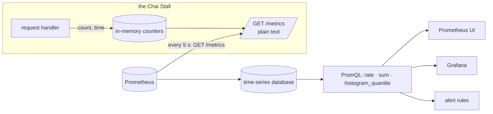

# Lab C06: Metrics and Prometheus

> ⏱ 60 min · 🟡 Intermediate · Needs: [C00](../C00-foundations/README.md), Docker + Compose, about 2 GB of free memory, ports 3000, 9090, 9093, 8025, 16686, 3100, 8091, 8092.
>
> This is the first of four observability labs. They all use the **same** stack, which you start once below and keep running through [C09](../C09-slo-incident-response/README.md).

## 🎯 What you'll learn
- What a **metric** is, and the three types: **counter, gauge, histogram**
- How Prometheus **scrapes** (pulls) metrics, and what `up` tells you for free
- **PromQL** from zero: selectors, `rate`, aggregation, ratios, percentiles
- **Recording rules**: pre-computing the numbers you rely on
- How to **instrument** your own service, and the **cardinality** trap

## 🧠 Concept in 60 seconds



A **time series** is "a number that changes over time, with a name and labels", for example `http_requests_total{method="POST",path="/order",status="200"}` = 1,483 *right now*, 1,490 five seconds later. Prometheus stores millions of these. **PromQL** is the language to ask questions of them.

## 🧪 Hands-on

### Step 1: Start the observability platform (3 min)
```bash
cd cicd-observability/projects/project-2-see-everything
docker compose up -d --build
docker compose ps
```
Ten containers start: two copies of the **app** (`chai-1`, `chai-2`), a **load generator** (customers!), **Prometheus**, **Alertmanager**, **Mailpit** (an inbox), **Loki** + **Alloy** (logs), **Jaeger** (traces) and **Grafana**. Give it a minute, then:
```bash
./scripts/verify.sh 1
```
Expect two ✔ lines. (A ✖ prints a hint.) Memory tight? `docker compose stop jaeger loki alloy` is fine for C06 and C07.

### Step 2: Read the raw metrics (8 min)
Metrics are not magic: they are **a web page of text**.
```bash
curl -s localhost:8091/metrics | head -40
```
You will see blocks like:
```
# HELP http_requests_total Requests handled, by method, route and status code.
# TYPE http_requests_total counter
http_requests_total{method="POST",path="/order",status="200"} 1483
# HELP http_requests_in_flight Requests being handled right now.
# TYPE http_requests_in_flight gauge
http_requests_in_flight 1
# TYPE http_request_duration_seconds histogram
http_request_duration_seconds_bucket{path="/order",le="0.005"} 1450
http_request_duration_seconds_bucket{path="/order",le="0.01"} 1480
...
http_request_duration_seconds_bucket{path="/order",le="+Inf"} 1483
http_request_duration_seconds_sum{path="/order"} 1.92
http_request_duration_seconds_count{path="/order"} 1483
```
Find each of the three types:

| Type | In the output | Behaviour | Use it with |
|---|---|---|---|
| **Counter** | `http_requests_total`, `orders_total` | only goes up (resets to 0 on restart) | `rate()` / `increase()` |
| **Gauge** | `http_requests_in_flight`, `chaos_error_rate` | goes up and down | the value itself, or `avg_over_time` |
| **Histogram** | `…_bucket{le="0.25"}`, `_sum`, `_count` | counts of observations **at or below** each bound `le` ("less or equal") | `histogram_quantile()` |

**Read a histogram.** `…_bucket{le="0.25"} 1483` means "1483 requests took 0.25 s **or less**". Buckets are *cumulative*, so each is ≥ the one before, and the `+Inf` bucket equals `_count`. From these Prometheus estimates percentiles: that is the p95 you will compute below.

Now produce a metric yourself and watch it move:
```bash
curl -s -X POST 'localhost:8091/order?item=samosa'
curl -s localhost:8091/metrics | grep '^orders_total'
```
Run the second command twice with an order in between: the `samosa` counter goes up by one. **That is instrumentation.** The app does it in about 40 lines ([`app.py`](../app/app.py): `record()` and `render_metrics()`); real services use a client library (`prometheus_client` for Python, `micrometer` for Java, `client_golang` for Go) that does the same thing.

### Step 3: How Prometheus finds its targets (5 min)
Open http://localhost:9090 → **Status → Targets**. Five groups, all **UP**. Now the config that produced them, [`prometheus/prometheus.yml`](../projects/project-2-see-everything/prometheus/prometheus.yml):
```yaml
global:
  scrape_interval: 5s            # lab speed; production 15-60 s
scrape_configs:
  - job_name: chai-stall
    metrics_path: /metrics
    static_configs:
      - targets: ["chai-1:8080"]
        labels: { instance_name: chai-1 }
```
A **job** is a group of targets with the same purpose; an **instance** is one target (`host:port`). Prometheus adds `job` and `instance` labels to everything it scrapes. `static_configs` is the simplest discovery; in real systems targets come from **service discovery** (Kubernetes, Consul, AWS, files) so new instances are found automatically. The job `chai-stall-prod` in this file uses *file-based discovery*, which you will use in [Project 2](../projects/project-2-see-everything/README.md) Phase 7.

Run your first query: in the **Graph** tab, type `up` and press **Execute**:
```
up{instance="chai-1:8080", job="chai-stall"}   1
up{instance="chai-2:8080", job="chai-stall"}   1
...
```
`1` = the last scrape worked; `0` = it failed. **You get "is it alive?" for free**, for every target, with no code in the app. Try it:
```bash
docker compose stop chai-2
```
Wait 10 seconds and execute `up` again: `chai-2` is now `0`. (It also **raises an alert**: that is C07.) Bring it back: `docker compose start chai-2`.

### Step 4: PromQL, one rung at a time (20 min)
Paste each query into the **Graph** tab. For each one, **predict the result before you execute it.**

| # | Query | What it means | Notes |
|---|---|---|---|
| 1 | `http_requests_total` | every request counter, one series per label combination | an *instant vector*; the numbers only grow |
| 2 | `http_requests_total{path="/order"}` | filter by label | `=` equal, `!=`, `=~` regex, `!~` |
| 3 | `http_requests_total{path="/order",status=~"5.."}` | only 5xx errors | **empty is normal** when nothing is failing! |
| 4 | `rate(http_requests_total{path="/order"}[1m])` | **per-second rate** over the last minute | this is how you use a counter |
| 5 | `sum(rate(http_requests_total[1m]))` | total requests/second, all labels merged | aggregation |
| 6 | `sum by (instance_name) (rate(http_requests_total{path="/order"}[1m]))` | orders/second **per instance** | `by` keeps a label |
| 7 | `sum by (status) (rate(http_requests_total[1m]))` | traffic split by status code | the "Errors" golden signal |
| 8 | `sum(rate(http_requests_total{status=~"5.."}[1m])) / sum(rate(http_requests_total[1m]))` | **error ratio** | empty while there are no errors (see Challenge) |
| 9 | `histogram_quantile(0.95, sum by (le) (rate(http_request_duration_seconds_bucket{path="/order"}[1m])))` | **p95 latency of orders** | 95% of orders were this fast or faster |
| 10 | `topk(2, sum by (item) (rate(orders_total[1m])))` | the two best-selling items | business metrics are metrics too |
| 11 | `increase(orders_total[5m])` | orders **in the last 5 minutes**, per item | `increase` = rate × time |
| 12 | `http_requests_in_flight` | a gauge: requests being handled right now | "saturation" |

Click the **Graph** sub-tab for 4, 6, 7, 9: a line over time.

**Things worth noticing**
- **Why `rate()` and not the raw counter?** Raw `http_requests_total` is a running total since the process started: 1,483, then restart, then 12. `rate()` handles the reset and gives *speed*, which is what you want to alert on or graph.
- **The window `[1m]`** is how far back to look. Too short = jittery; too long = slow to react. Use at least 4× the scrape interval.
- **Why `sum by (le)` inside `histogram_quantile`?** The function needs the buckets (labelled `le`) merged across all instances first; you cannot average percentiles, but you *can* add bucket counts.
- **Empty is not zero.** Query 3 returns *no series* when there are no errors, and query 8 then returns nothing. A dashboard showing "no data" during a healthy hour is confusing, so well-built rules add `or vector(0)` (look at [`recording.yml`](../projects/project-2-see-everything/prometheus/rules/recording.yml)).
- **Two ways to see the same number:** `curl -sG localhost:9090/api/v1/query --data-urlencode 'query=sum(rate(http_requests_total[1m]))'` returns JSON: this API is what Grafana and scripts use.

Make the numbers move. Add traffic to one instance and watch query 6 respond:
```bash
for i in $(seq 1 300); do curl -s -o /dev/null -X POST 'localhost:8091/order?item=chai'; done
```
Query 6 now shows `chai-1` well above `chai-2` for a minute. Stop the background customers and watch everything fall to zero:
```bash
docker compose stop loadgen          # query 5 drops to 0
docker compose start loadgen
```

### Step 5: Recording rules (5 min)
A query you run on every dashboard refresh and in every alert is worth computing **once**. Open **Status → Rule health** (or **Alerts** and **Status → Rules**) in the UI, and read [`prometheus/rules/recording.yml`](../projects/project-2-see-everything/prometheus/rules/recording.yml):
```yaml
- record: sli:order_errors:ratio_rate5m
  expr: |
    (sum(rate(http_requests_total{job="chai-stall",path="/order",status=~"5.."}[5m])) or vector(0))
    / sum(rate(http_requests_total{job="chai-stall",path="/order"}[5m]))
```
Query the **recorded** series directly: `sli:order_errors:ratio_rate5m`. It is a normal metric, so dashboards and alerts use the short name. The naming convention `level:metric:operations` tells you what it is. These rules are also **unit-tested**, without a running Prometheus:
```bash
docker run --rm -v "$PWD":/w -w /w --entrypoint promtool prom/prometheus:v3.5.0 test rules tests/rules_test.yml
```
Expected: `SUCCESS`. Open [`tests/rules_test.yml`](../projects/project-2-see-everything/tests/rules_test.yml): it feeds fake time series (`values: '0+30x40'` means "start at 0, add 30 each step, 40 steps") and asserts which alerts fire. **Alerts are code, so they get tests**; the GitHub Actions workflow in [C01](../C01-git-based-ci/README.md) runs exactly this command on every pull request.

### Step 6: Instrumenting your own service: the rules of thumb
- **Count requests, errors, and time them** (the RED method) at the edge of your service; add **business counters** (`orders_total`).
- **Name things well:** `snake_case`, a unit suffix (`_seconds`, `_bytes`), `_total` for counters.
- **Beware cardinality.** Every distinct label combination is a separate series stored in memory. A label with an unbounded set of values (user id, email, raw URL path, request id) creates millions of series and can crash Prometheus. That is why the Chai Stall's `route_label()` maps unknown paths to `other`. Try it:
```bash
for i in 1 2 3 4 5; do curl -s -o /dev/null localhost:8091/random-path-$i; done
curl -s localhost:8091/metrics | grep 'path="other"'         # five different URLs, ONE series
```
- **Never put secrets or personal data in labels.** Labels are indexed, shown in dashboards and kept for weeks.
- Libraries and **exporters** cover the rest: `node_exporter` (machine CPU/memory/disk), `cAdvisor` (containers), `kube-state-metrics` ([K19](../../kubernetes/19-observability/README.md)), `blackbox_exporter` (probe a URL from outside).

## 🏭 In production
- Prometheus is **single-node and local-disk**: great for weeks of data. For long retention or many clusters add **Thanos / Mimir / VictoriaMetrics**, which are PromQL-compatible.
- **Scrape interval** 15 to 60 s is normal; our 5 s is for impatient learners.
- Keep an eye on Prometheus itself: its own metrics (`prometheus_tsdb_head_series`) tell you how many series it holds, which is your cardinality gauge.
- Use **recording rules** for every number that appears in an SLO or an alert, and **unit-test** the rules in CI.

## 🏆 Challenge
Write **one** PromQL query that returns the percentage of `/order` requests slower than 250 ms over the last 5 minutes, using only the histogram. (Hint: the bucket `le="0.25"` counts the fast ones.)

<details><summary>Check your answer</summary>

```
1 - (
  sum(rate(http_request_duration_seconds_bucket{path="/order",le="0.25"}[5m]))
  /
  sum(rate(http_request_duration_seconds_count{path="/order"}[5m]))
)
```
The fraction **at or under** 250 ms is `bucket{le="0.25"} / count`; the slow ones are `1 -` that. Multiply by 100 for a percentage. This "fast / total" fraction is a **latency SLI**: the very ratio the recording rule `sli:order_latency_good:ratio_rate5m` in C09 computes. (Healthy it returns about 0.)
</details>

## ✅ Checkpoint
<details><summary>1. A counter shows 12,000 and a minute later 12,060. What is the rate?</summary>

60 requests in 60 s = **1 per second**. `rate(x[1m])` computes this for you and copes with restarts.
</details>

<details><summary>2. Why can you not average the p95 of two instances to get the overall p95?</summary>

A percentile of percentiles is meaningless (a busy slow instance and an idle fast one would count equally). Add the **bucket counts** across instances (`sum by (le)`), then compute the quantile once.
</details>

<details><summary>3. What does <code>up == 0</code> mean, and what code did the app need to provide it?</summary>

The last scrape of that target failed (down, crashed, unreachable, or `/metrics` returned an error). **None**: Prometheus creates `up` itself. This is a benefit of the pull model.
</details>

<details><summary>4. Why is <code>user_id</code> a bad label?</summary>

Unbounded cardinality: one new time series per user. Memory grows without limit and queries slow down. Put per-user detail in **logs** or **traces**, not metrics.
</details>

## 🧹 Cleanup
Keep the stack running for C07 to C09. (`docker compose stop` pauses it; `docker compose down -v` removes it and its data.)

➡️ Next: [C07 · Alerting and Grafana](../C07-alerting-grafana/README.md)
