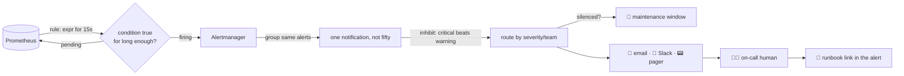
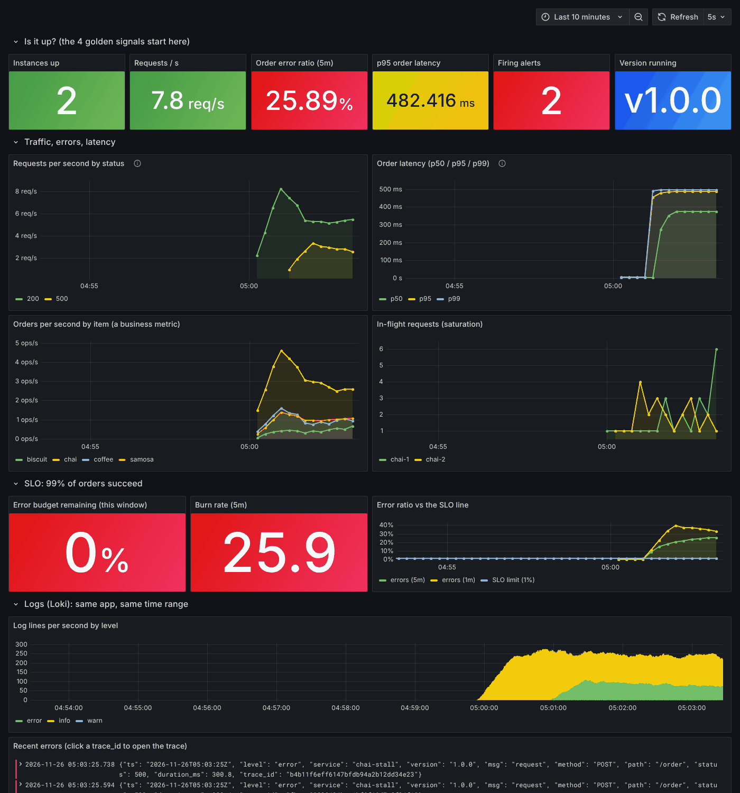

# Lab C07: Alerting with Alertmanager, and Grafana Dashboards

> ⏱ 60 min · 🟡 Intermediate · Needs: the Project 2 stack running ([C06](../C06-prometheus/README.md), Step 1). Keep Mailpit open at **http://localhost:8025**: it is your inbox.

## 🎯 What you'll learn
- The anatomy of an **alert rule**, and the life cycle **inactive → pending → firing → resolved**
- What **Alertmanager** adds: **grouping, routing, silencing, inhibition**
- How to receive a real **alert email** and read it
- **Grafana**: data sources, dashboards, the four golden signals on one screen
- **Dashboards as code**: provisioned from files in Git
- What makes an alert **good** (and why most alerts are bad)

## 🧠 Concept in 60 seconds



**Prometheus decides *whether* an alert is firing. Alertmanager decides *who hears, how, and how often*.** They are separate on purpose, so you can have 20 Prometheus servers and one place that manages on-call routing.

## 🧪 Hands-on

### Step 1: Read an alert rule (5 min)
Open [`prometheus/rules/alerts.yml`](../projects/project-2-see-everything/prometheus/rules/alerts.yml):
```yaml
- alert: ChaiStallInstanceDown
  expr: up{job="chai-stall"} == 0                # the condition (any PromQL that returns series = "true")
  for: 15s                                      # must stay true this long before it FIRES
  labels: { severity: critical, team: stall }   # used for ROUTING
  annotations:                                  # used by HUMANS
    summary: "{{ $labels.instance_name }} is down"
    description: "Prometheus cannot scrape {{ $labels.instance }} for 15s. Runbook: docs/runbook.md#instance-down"
```
| Part | Purpose |
|---|---|
| `expr` | the question. Any series it returns counts as "alerting" |
| `for` | **patience**: a single failed scrape should not wake anyone. Lab: 15 s. Production: usually 2 to 10 minutes |
| `labels` | key-value tags that Alertmanager **routes** on (`severity`, `team`) |
| `annotations` | text with **templates** (`{{ $labels.x }}`, `{{ $value }}`) for humans; always include a **runbook link** |

**Life cycle:** *inactive* (condition false) → *pending* (true, waiting out `for`) → *firing* (true long enough, sent to Alertmanager) → *resolved* (false again; Alertmanager sends a "resolved" notice).

### Step 2: Make an alert fire, and receive it (10 min)
Open three browser tabs: **Prometheus Alerts** (http://localhost:9090/alerts), **Alertmanager** (http://localhost:9093) and **Inbox** (http://localhost:8025). Then:
```bash
cd cicd-observability/projects/project-2-see-everything
docker compose stop chai-2          # kill one of the two instances
```
Watch, and write down the time of each change:
1. **~5 s**: in Prometheus Alerts, `ChaiStallInstanceDown` goes **pending** (yellow).
2. **~20 s**: it turns **firing** (red). It is now in Alertmanager (tab 2).
3. **~40 s**: an email arrives in the Inbox: **`[FIRING] ChaiStallInstanceDown (critical)`**. Why not immediately? Alertmanager waits `group_wait: 10s` to collect related alerts into **one** message.

Open the email. It shows the summary and description. Now heal it:
```bash
docker compose start chai-2
```
About 30 seconds later a second email arrives: **`[RESOLVED] ChaiStallInstanceDown`**. You have just lived through a miniature incident, with detection, notification and resolution confirmed by a machine.

Check the dashboard for the same event: Grafana → **Chai Stall: Service Overview** (next steps): *Instances up* dropped to 1 and recovered.

### Step 3: Alertmanager: grouping, routing, inhibition (10 min)
Open [`alertmanager/alertmanager.yml`](../projects/project-2-see-everything/alertmanager/alertmanager.yml):

| Setting | Meaning | Why |
|---|---|---|
| `group_by: [alertname]` | alerts with the same name become **one notification** | 50 pods down is **one** page, not 50 |
| `group_wait: 10s` | wait this long for more alerts before the first message | collects the burst |
| `group_interval: 30s` | wait this long before sending an update about the same group | avoids a flood |
| `repeat_interval: 1h` (15 m for critical) | re-send while still firing | "still broken" reminders |
| `routes: matchers: [severity="critical"]` | send different alerts to different places | critical → pager; warning → Slack; info → ticket |
| `receivers: email_configs` | the actual notification; here, SMTP to Mailpit | in real life Slack, PagerDuty, Opsgenie, webhook |
| `inhibit_rules` | when a **critical** is firing, suppress the **warning** about the same `team` | no point telling you "slow" when it is "down" |

**Silence (planned maintenance).** You are about to restart an instance on purpose, and you do not want a page. Silence it:
```bash
docker compose exec -T alertmanager amtool silence add alertname=ChaiStallInstanceDown \
  --duration=10m --comment="planned maintenance" --author=me --alertmanager.url=http://localhost:9093
docker compose stop chai-2
```
Wait a minute. The alert is **firing** in Prometheus, but **no email** arrives; in Alertmanager the alert shows as *suppressed*. (Silences are also in the UI: **Silences → New Silence**.) Now remove the silence and restore:
```bash
docker compose start chai-2
docker compose exec -T alertmanager amtool silence expire \
  $(docker compose exec -T alertmanager amtool silence query -q --alertmanager.url=http://localhost:9093) \
  --alertmanager.url=http://localhost:9093
```
A silence has an **owner, a reason and an end time**. Never silence forever.

**A latency alert.** `ChaiStallHighLatency` fires when the p95 of orders passes 0.5 s. Make the stall slow (700 ms extra per order) on both instances:
```bash
for p in 8091 8092; do curl -s -X POST "localhost:$p/chaos?latency_ms=700"; done
```
Query `job:order_latency_p95:5m` in Prometheus and watch it climb past 0.5 over about 30 seconds; the alert is *pending* then *firing* at ~55 s, and a **`[FIRING] ChaiStallHighLatency (warning)`** email arrives. (It is a *warning*, so it takes the quieter route.) Heal it:
```bash
for p in 8091 8092; do curl -s -X POST "localhost:$p/chaos/reset"; done
```
> The latency alert is *slower* than the instance-down alert because it measures a **5-minute window**. Alerts built on rates always lag by about the window length. Short windows react faster but flap; long ones are steady but late. The SLO burn-rate alerts in [C09](../C09-slo-incident-response/README.md) use **two windows at once** to get both.

### Step 4: Test the alert rules without breaking anything (5 min)
You do not have to break production to find out whether a rule works. [`tests/rules_test.yml`](../projects/project-2-see-everything/tests/rules_test.yml) feeds fake data to the rules:
```bash
docker run --rm -v "$PWD":/w -w /w --entrypoint promtool prom/prometheus:v3.5.0 check rules prometheus/rules/recording.yml prometheus/rules/alerts.yml
docker run --rm -v "$PWD":/w -w /w --entrypoint promtool prom/prometheus:v3.5.0 test rules tests/rules_test.yml
```
Both print `SUCCESS`. Now break a rule on purpose and see the test catch it: in `alerts.yml` change `up{job="chai-stall"} == 0` to `== 1`, rerun the `test rules` command: it **fails** and prints what it expected versus what it got. Undo with `git checkout prometheus/rules/alerts.yml`.

### Step 5: Grafana: look first, build second (15 min)
Open **http://localhost:3000**, log in with `admin` / `z2h-grafana`, and open **Dashboards → Chai Stall: Service Overview**. (If the load generator has been off, `docker compose start loadgen` and give it a minute.)


*(The picture is from an incident; yours is green until you break something.)*

Read it top to bottom. It is laid out as the **four golden signals**:

| Row | Panels | Golden signal |
|---|---|---|
| **Is it up?** | Instances up · Requests/s · Order error ratio · p95 latency · Firing alerts · Version running | the "at a glance" strip |
| **Traffic, errors, latency** | Requests/s by status · latency p50/p95/p99 · orders per item · in-flight | **Traffic**, **Errors**, **Latency**, **Saturation** |
| **SLO** | error budget remaining · burn rate · error ratio vs the 1% line | C09 |
| **Logs** | log lines by level · recent errors | C08 |

Spend five minutes **exploring**:
1. Hover on a graph line: the tooltip shows every series at that time.
2. Click a panel title → **Explore** to see its query in PromQL; change it and press **Run**.
3. Change the time range (top right) to **Last 5 minutes** and turn **Refresh** to 5s.
4. Click a legend entry to isolate a series.

**Build your own panel.** Top right, **Add → Visualization**, choose the **Prometheus** data source and enter:
```
sum by (item) (increase(orders_total[5m]))
```
Choose **Bar gauge** instead of *Time series* (top-right of the panel editor), give it a title, **Back to dashboard**. You made a panel in two minutes. Now notice you cannot **Save** it: the dashboard is *provisioned*, which leads to the real lesson.

### Step 6: Dashboards as code (5 min)
Click-built dashboards live in Grafana's database: lose it and they are gone, and nobody reviews changes. This one lives in **Git**:
```
grafana/provisioning/datasources/datasources.yml   ← Prometheus, Loki, Jaeger (uids: prometheus, loki, jaeger)
grafana/provisioning/dashboards/dashboards.yml     ← "load every JSON file from this folder"
grafana/dashboards/chai-stall.json                 ← the dashboard
```
Edit the file and watch Grafana follow, with no restart:
```bash
sed -i.bak 's/"title": "Chai Stall: Service Overview"/"title": "Chai Stall: Service Overview (mine)"/' grafana/dashboards/chai-stall.json && rm grafana/dashboards/chai-stall.json.bak
sleep 20
curl -s -u admin:z2h-grafana "localhost:3000/api/search?query=Chai" | grep -o '"title":"[^"]*"'
git checkout grafana/dashboards/chai-stall.json         # undo
```
To keep a dashboard you built in the UI: **Dashboard settings → JSON Model → copy**, and save it as a file in `grafana/dashboards/`. Review it in a pull request like any other code. That is how teams keep 200 dashboards sane.

> Grafana does not *store* data; it **asks** data sources (Prometheus, Loki, Jaeger, SQL, cloud APIs) and draws the answer. One dashboard can mix all three pillars; you will see that in C08.

## 🏭 In production: what makes an alert good
- **Alert on symptoms users feel** (errors, latency, "orders failing"), **not on causes** ("CPU at 80%"). A CPU spike that hurts nobody should not wake anybody. Use cause metrics to *diagnose*, symptoms to *page*.
- **Every page must be actionable and urgent.** If the right response is "ignore it until morning", it should be a ticket, not a page. **Alert fatigue** is a safety problem: people ignore the 50th false alarm, including the real one.
- **Every alert links to a runbook** ([ours](../projects/project-2-see-everything/docs/runbook.md)) and says *what it means, how to check, how to fix*.
- Page on **SLO burn rate** (C09) instead of raw thresholds wherever you can.
- Route by **severity and team**; have a **dead-man's switch** (an always-firing alert that pages you when it *stops*, proving the alerting pipeline itself is alive).
- **Review alerts** quarterly: delete the ones nobody acted on.

## 🏆 Challenge
Add a new **warning** alert, `OrdersStopped`, that fires when the stall has had **no orders at all for 1 minute** (a quiet period that may mean the front door is broken, not that nobody is thirsty). Write the rule, **a promtool test for it**, and load it without restarting Prometheus.

<details><summary>Check your answer</summary>

Add to `alerts.yml` under `chai-stall-symptoms`:
```yaml
      - alert: OrdersStopped
        expr: sum(rate(orders_total[1m])) == 0
        for: 1m
        labels: { severity: warning, team: stall }
        annotations:
          summary: "No orders in the last minute"
          description: "Nobody is ordering. Is the front door broken? Runbook: docs/runbook.md#no-orders"
```
A test in `tests/rules_test.yml`:
```yaml
  - name: silence at the counter is noticed
    interval: 15s
    input_series:
      - series: 'orders_total{item="chai"}'
        values: '0+10x10 100x20'          # grows, then goes flat
    alert_rule_test:
      - eval_time: 5m
        alertname: OrdersStopped
        exp_alerts:
          - exp_labels: { severity: warning, team: stall }
            exp_annotations:
              summary: "No orders in the last minute"
              description: "Nobody is ordering. Is the front door broken? Runbook: docs/runbook.md#no-orders"
```
Run `promtool test rules`, then reload Prometheus **without a restart**: `curl -X POST localhost:9090/-/reload` (that works because the container runs with `--web.enable-lifecycle`). Prove it fires: `docker compose stop loadgen` and wait ~90 s. Restart `loadgen` to resolve it.
</details>

## ✅ Checkpoint
<details><summary>1. Why does the alert wait (<code>for: 15s</code>) before firing?</summary>

To ignore blips: one failed scrape or one slow second should not page a human. The condition must hold for the whole `for` period. (In production the wait is minutes, traded against detection speed.)
</details>

<details><summary>2. Prometheus shows an alert as <em>firing</em>, but no email arrived. Name three places to look.</summary>

(1) **Alertmanager** UI: is the alert there, or *suppressed* by a silence or an inhibit rule? (2) The **route**: did it match the receiver you expected? (3) The **receiver**: SMTP settings and the Alertmanager log (`docker compose logs alertmanager`). Also: is it still within `group_wait`/`group_interval`?
</details>

<details><summary>3. Why keep dashboards in Git?</summary>

Review (pull requests), history ("who removed that panel?"), reproducibility (a new environment gets the same dashboards), and disaster recovery.
</details>

<details><summary>4. A teammate wants an alert "when CPU > 70%". How do you respond?</summary>

Ask what the user feels when it happens. If nothing, it is a *cause* metric: put it on a dashboard, not in a pager. If it predicts an impending outage (for example, a disk filling), alert on the *prediction* (`predict_linear`) or on saturation of the resource that users depend on.
</details>

## 🧹 Cleanup
`docker compose start chai-2 loadgen` (if you left anything stopped), and `curl -s -X DELETE localhost:8025/api/v1/messages` to empty the inbox.

➡️ Next: [C08 · Logs and traces](../C08-logs-and-traces/README.md)
