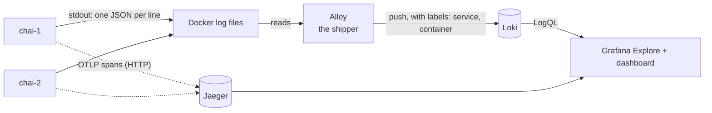

# Lab C08: Centralized Logging (Loki) and Traces (Jaeger)

> ⏱ 50 min · 🟡 Intermediate · Needs: the Project 2 stack running ([C06](../C06-prometheus/README.md), Step 1), including `loki`, `alloy` and `jaeger`.

## 🎯 What you'll learn
- Why logs must be **centralized**, and what **structured (JSON) logging** buys you
- How logs travel: **app → stdout → Alloy → Loki → Grafana**
- **LogQL**: select streams, filter lines, parse JSON, filter on fields, turn logs into numbers
- What a **trace** and a **span** are, and read one in **Jaeger**
- **Join the three pillars**: metric alert → log lines → trace, using the `trace_id`

## 🧠 Concept in 60 seconds

**Why centralize?** In the previous labs you used `docker compose logs chai-1`. That works for one container on your laptop. In production you have 40 instances that appear and disappear: a container's logs vanish **with** the container, and nobody can `ssh` into forty machines to `grep`. So a **log shipper** reads every container's output and sends it to one searchable place.



**Loki's trick:** it indexes only the **labels** (`service`, `container`), *not* the text. That makes it small and cheap, and fast when you first narrow by labels (`{service="chai-1"}`) and then grep inside. (Elasticsearch indexes every word: more powerful searching, much more storage and operations.)

**Structured logs.** Compare:
```
2026-11-26 05:26:09 ERROR order failed for chai after 0.2s on chai-1                 ← a sentence: to find anything you must parse prose
{"level":"error","path":"/order","status":500,"duration_ms":0.2,"trace_id":"5d06…"}   ← data: filter on status, graph duration_ms, join on trace_id
```
The Chai Stall writes the second kind. One JSON object per line, always with the same keys, is the single best logging habit.

## 🧪 Hands-on

### Step 1: Raw logs and where they go (5 min)
```bash
cd cicd-observability/projects/project-2-see-everything
docker compose logs --tail 3 chai-1
```
Each line is JSON (`ts, level, service, version, msg, method, path, status, duration_ms, trace_id`). Now see the shipper's config, [`alloy/config.alloy`](../projects/project-2-see-everything/alloy/config.alloy), four small blocks:

| Block | Job |
|---|---|
| `discovery.docker` | ask the Docker engine for containers **labelled `logging=true`** (the app services have that label in `docker-compose.yml`) |
| `discovery.relabel` | turn Docker's metadata into Loki **labels**: `service` (from the Compose service name) and `container` |
| `loki.source.docker` | read each container's log stream |
| `loki.write` | push to `http://loki:3100` |

Add the label to any container and its logs are collected: no change to the app. (The older shipper, Promtail, was retired in 2026 in favour of **Grafana Alloy**, which is also the collector for metrics and traces: one agent for all three pillars.)

### Step 2: Explore logs in Grafana (15 min)
Open **http://localhost:3000** → **Explore** (compass icon, left) → choose the **Loki** data source at the top. Use the **Code** mode (right of the query box) and run these. For each, **predict first**.

| # | LogQL | What it does |
|---|---|---|
| 1 | `{service="chai-1"}` | **stream selector**: every line from one service. Always start here: it is what makes Loki fast |
| 2 | `{service=~"chai-.*"}` | regex on the label: both instances |
| 3 | `{service=~"chai-.*"} \|= "/order"` | **line filter**: only lines containing `/order` (`!=` excludes, `\|~` is regex) |
| 4 | `{service=~"chai-.*"} \| json` | **parse** each line as JSON, turning its keys into labels |
| 5 | `{service=~"chai-.*"} \| json \| level="error"` | filter on a parsed field: only errors (empty if healthy) |
| 6 | `{service=~"chai-.*"} \| json \| status >= 500` | numeric comparison on a parsed field |
| 7 | `{service=~"chai-.*"} \| json \| duration_ms > 100` | slow requests |
| 8 | `{service=~"chai-.*"} \| json \| line_format "{{.method}} {{.path}} -> {{.status}} in {{.duration_ms}}ms"` | **reformat** each line for reading |
| 9 | `sum by (level) (count_over_time({service=~"chai-.*"} \| json \| __error__="" [1m]))` | **logs → numbers**: lines per level, per minute (graph it) |
| 10 | `sum by (service) (rate({service=~"chai-.*"} \| json \| level="error" [1m]))` | error lines per second, per instance |

(Type the pipe as a plain `|`: the backslashes above only escape it in this table.)

**Why `__error__=""` in #9?** A single malformed line (for example one cut off when a container is killed mid-write) makes the JSON parser attach an error, and Loki then **refuses the whole metric query** with `pipeline error: 'JSONParserErr'`. Adding `| __error__=""` skips the bad lines. The shipped dashboard has it for exactly that reason. In production, *log pipelines have bad lines*: plan for them.

**Make some errors to find.** Turn on failures for both instances and keep it on for the next steps:
```bash
for p in 8091 8092; do curl -s -X POST "localhost:$p/chaos?error_rate=0.3"; done
```
Re-run #5, #6, #8 and #10. Now you have failing requests to hunt.

### Step 3: Logs on the dashboard, next to the metrics (3 min)
Open **Dashboards → Chai Stall: Service Overview** and scroll to **Logs**: a stacked bar of log lines per level (a metric *made from logs*) and below it **Recent errors**, a live log panel. Same time range, same page as the error-ratio graph. **When the error ratio line rises, you can read the lines that caused it, one scroll away.** That is the first join: *metrics tell you when, logs tell you what.*

### Step 4: Traces: one request's journey (10 min)
A **trace** is the story of one request; a **span** is one chapter in it (a unit of work with a start, an end, a name, and attributes). In a real system a single click crosses a web server, an API, a database and a cache, producing a tree of spans. The trace shows **where the time went**.

Open **Jaeger: http://localhost:16686**. Choose **Service: `chai-stall`**, **Find Traces**. Click one:
- the **span name** (`POST /order`), **duration**, and **attributes** (`http.status_code`, `http.route`, `host.name` = which instance);
- error spans have `otel.status_code=ERROR` and a red marker.

Find the failures: in **Tags** enter `http.status_code=500` → **Find Traces**. Each result is one failed order.

**See a trace across two services.** The Chai Stall is a single service, so each trace has one span. But a trace is just spans that **share a `trace_id`**, so you can build a two-hop trace by hand: call two instances with the same ID, the way an API gateway would pass it along (the `X-Trace-Id` header):
```bash
T=$(python3 -c 'import secrets; print(secrets.token_hex(16))')
curl -s -o /dev/null -H "X-Trace-Id: $T" -X POST localhost:8091/order
curl -s -o /dev/null -H "X-Trace-Id: $T" -X POST localhost:8092/order
echo "open: http://localhost:16686/trace/$T"
```
Open that URL: **one trace, two spans**, from two different hosts. (Real systems propagate the ID automatically, using the W3C `traceparent` header; and spans carry a `parentSpanId` so Jaeger draws a tree. The app sends spans by hand with about 25 lines of code ([`send_span`](../app/app.py)): OpenTelemetry SDKs do the same thing for you and cover dozens of frameworks.)

### Step 5: Join the pillars (10 min): the on-call skill
With errors still on (`error_rate=0.3`), follow a failure from symptom to cause. This is the loop you will use in [C09](../C09-slo-incident-response/README.md) and in every real incident:

1. **Metrics (detect):** dashboard → *Order error ratio* is red; *Firing alerts* may already say 1 or 2. *When* did it start? Which instance?
2. **Logs (what):** Explore → Loki → `{service=~"chai-.*"} | json | level="error"`. Same message every time? Which path? (`"msg": "request", "status": 500`.)
3. **Pick one failed line and expand it** (click the `>` at its left). Scroll to the bottom of the details: under **Links** there is a **trace_id** link. Click it.
4. **Traces (where):** Grafana opens the matching trace from Jaeger beside the log line (a split view). You went from a graph to a log line to a trace **in three clicks**, because every log line and every span carry the same `trace_id`.

How the link works (and why we set it up): in [`datasources.yml`](../projects/project-2-see-everything/grafana/provisioning/datasources/datasources.yml) the Loki data source has a *derived field*:
```yaml
derivedFields:
  - { name: trace_id, matcherRegex: '"trace_id": "(\w+)"', url: "$${__value.raw}", datasourceUid: jaeger }
```
"Find `"trace_id": "<hex>"` in every line, and make it a link into the Jaeger data source." That is the entire integration: **a shared ID in your logs**. The cheapest, highest-value observability habit there is. Now stop the errors:
```bash
for p in 8091 8092; do curl -s -X POST "localhost:$p/chaos/reset"; done
```

### Step 6: Log hygiene (reading, 5 min)
- **Levels:** `debug` (noisy, off in production), `info` (normal events), `warn` (odd but handled), `error` (a request or job failed). In this app, 5xx responses are `error`, everything else `info`.
- **Never log secrets or personal data**: passwords, tokens, full card numbers, emails, phone numbers. Logs are copied to many systems and kept for weeks. Scrub at the source.
- **Always log an ID that ties lines together** (`trace_id`, request id): a log line without one is a clue you cannot follow.
- **Volume costs money.** Log events that someone will *use*; sample the noisy ones; set **retention** (this Loki keeps 48 h).
- **Logs are not metrics.** Counting errors from log lines (#9, #10) works for a quick look, but alerts and SLOs should rest on real **metrics** (cheap, exact, fast).

## 🏭 In production
- **Collection:** a log agent on every node (Alloy, Fluent Bit, Vector) or a sidecar; in Kubernetes a DaemonSet reading `/var/log/pods`.
- **Storage:** Loki on object storage (S3/GCS), or Elasticsearch/OpenSearch, or a managed service. Plan **retention** and **access control** (logs contain sensitive facts).
- **Traces:** apps use the **OpenTelemetry** SDK or auto-instrumentation and send OTLP to an **OpenTelemetry Collector**, which fans out to Jaeger/Tempo/a vendor. Production systems **sample** traces (keep 1–10%, plus all errors and slow ones) because keeping every span is expensive.
- **Correlation everywhere:** put `trace_id` in logs, and **exemplars** (a trace id attached to a metric sample) in histograms, so even a latency graph can link to a slow trace.

## 🏆 Challenge
Without opening the dashboard, find out **which of the two instances logged more than 5 server errors in the last 5 minutes** (with chaos on, it will be both; with chaos off, none). Write a single LogQL metric query that returns only instances over the threshold.

<details><summary>Check your answer</summary>

```
sum by (service) (count_over_time({service=~"chai-.*"} | json | __error__="" | status >= 500 [5m])) > 5
```
`count_over_time` turns lines into a count per instance; the trailing `> 5` is a **filter on the result** (like a PromQL comparison), so only instances above 5 are returned. This works for a quick look. For an *alert* you would count with a Prometheus metric: `sum by (instance_name) (increase(http_requests_total{status=~"5.."}[5m])) > 5`: cheaper and exact.
</details>

## ✅ Checkpoint
<details><summary>1. Why does Loki ask you to start with <code>{service="…"}</code>?</summary>

Only labels are indexed. The label selector narrows to a few log streams quickly; the rest of the query then greps through only those lines.
</details>

<details><summary>2. A request is slow. Which pillar tells you <em>where</em>, and which tells you <em>that</em> it is slow?</summary>

**Metrics** tell you *that* (p95 up) and how widespread it is. **Traces** tell you *where* the time went (which span). **Logs** add *what* happened (the error, the arguments).
</details>

<details><summary>3. What single piece of data lets you jump from a log line to its trace?</summary>

The shared **`trace_id`**, written into every log line and every span, plus a link rule (Grafana's derived field).
</details>

<details><summary>4. Why is it wise to alert on a Prometheus metric rather than a LogQL count?</summary>

Metrics are cheap, exact and evaluated every few seconds; log queries scan text, depend on parsing (a malformed line can break them) and cost more. Use logs to *investigate*, metrics to *alert*.
</details>

## 🧹 Cleanup
`for p in 8091 8092; do curl -s -X POST "localhost:$p/chaos/reset"; done` (if you have not already).

➡️ Next: [C09 · SLIs, SLOs, SLAs and incident response](../C09-slo-incident-response/README.md)
