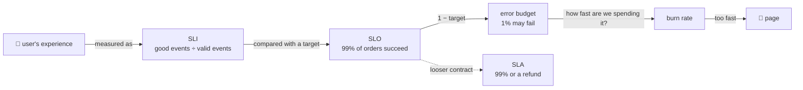

# Lab C09: SLIs, SLOs, SLAs and Incident Response

> ⏱ 75 min · 🟡→🔴 · Needs: the See Everything stack running with the dashboard and the inbox open ([C06](../C06-prometheus/README.md) to [C08](../C08-logs-and-traces/README.md)).
>
> This lab ends with a **game day**: three incidents, a timeline, a postmortem.

## 🎯 What you'll learn
- Choose good **SLIs**, set an **SLO**, and tell it apart from an **SLA**
- Calculate an **error budget** and watch it burn
- Understand **burn-rate alerts** with two windows, and why they beat "error rate above X%"
- Run incidents: **detect → triage → mitigate → resolve → postmortem**, with a runbook
- Measure your own **time to detect** and **time to mitigate**

## 🧠 Concept in 60 seconds



An SLI is **a ratio of good events to all valid events**: always between 0 and 1 (or 0–100%), so any two SLIs speak the same language. For the Chai Stall:

| SLI | "Good" event | "Valid" events | Where it comes from |
|---|---|---|---|
| **Availability** | an `/order` request that did **not** return 5xx | all `/order` requests | `sli:order_errors:ratio_rate*` (this is the *bad* share; good = 1 − it) |
| **Latency** | an `/order` answered in **≤ 250 ms** | all `/order` requests | `sli:order_latency_good:ratio_rate5m` |

**Our SLOs** (the targets, over a rolling **30 days**):
- **Availability: 99%** of orders succeed → error budget **1%**.
- **Latency: 95%** of orders finish within 250 ms.

(99% is deliberately loose so the lab is easy to burn. A payment system would aim for 99.95% or better.)

Notice what is **not** an SLI: CPU, memory, queue depth. Those are *causes* you watch on a dashboard. SLIs measure *what users feel*.

## 🧪 Hands-on

### Step 1: See the SLIs (10 min)
Open Prometheus (http://localhost:9090) and run these. With the stall healthy, expect a good picture:
```
sli:order_errors:ratio_rate5m                  # share of orders failing: 0 when healthy
1 - sli:order_errors:ratio_rate5m              # availability SLI: 1 (= 100%)
sli:order_latency_good:ratio_rate5m            # share of orders answered within 250 ms: ~1
```
These are **recording rules** ([`recording.yml`](../compose-edition/see-everything/prometheus/rules/recording.yml)). They pre-compute the ratio over several windows (1 m, 5 m, 30 m) so alerts and dashboards use one **consistent definition** of "failing". Open the file and read the comment on `or vector(0)`: without it, a perfectly healthy service would show *no data* instead of *zero errors*.

### Step 2: The error budget, with numbers (10 min)
An SLO of 99% over 30 days means a budget of **1% of orders**. If the stall serves 100,000 orders a month, **1,000 may fail**. Spend them wisely: a bad release that fails 50% of orders burns 1,000 in:

```
orders per minute = 100,000 / 43,200 min ≈ 2.3/min       (a quiet stall)
failures per minute at 50% failing ≈ 1.2/min
budget gone after ≈ 1,000 / 1.2 ≈ 14 hours
```
In the lab the load is 8 orders/second, so the budget disappears faster; the *ratio* thinking is the same. The dashboard shows two SLO panels:
- **Error budget remaining** = `clamp_min(1 - sli:order_errors:ratio_rate30m / 0.01, 0)`: 100% when nothing fails, 0% when the failing share has reached 1% of orders.
- **Burn rate** = `sli:order_errors:ratio_rate5m / 0.01`: **1 means "spending exactly the whole budget over 30 days"**. 2 means twice as fast; **14.4 means the whole 30-day budget would last about 2 days** (30 ÷ 14.4).

| Burn rate | Budget lasts | Speed | What to do |
|---|---|---|---|
| 1 | 30 days | exactly on budget | nothing |
| 3 | 10 days | a slow leak | ticket: fix this week |
| 6 | 5 days | worrying | fix today |
| 14.4 | 2 days | **fast burn** | **page now** |
| 100 | 7 hours | outage | all hands |

### Step 3: Burn-rate alerts: read them (5 min)
Open the second group in [`alerts.yml`](../compose-edition/see-everything/prometheus/rules/alerts.yml):
```yaml
- alert: OrderSLOFastBurn
  expr: |
    sli:order_errors:ratio_rate5m > (14.4 * 0.01)
    and sli:order_errors:ratio_rate1m > (14.4 * 0.01)
  for: 15s
  labels: { severity: critical }

- alert: OrderSLOSlowBurn
  expr: |
    sli:order_errors:ratio_rate30m > (3 * 0.01)
    and sli:order_errors:ratio_rate5m > (3 * 0.01)
  for: 1m
  labels: { severity: warning }
```
**Why two windows joined with `and`?**
- The **long** window (5 m / 30 m) proves the problem is **real and costs budget** (a 10-second blip cannot move a 30-minute average much).
- The **short** window (1 m / 5 m) proves it is **still happening now**: it makes the alert **reset quickly** after the fix, instead of staying red for half an hour.
Together: *"it has been bad for a while **and** it is still bad."* That kills both false alarms and stale alarms.

**Why these numbers?** They come from the Google SRE workbook: page on **14.4× over 1 h** (2% of the monthly budget consumed in an hour) and ticket on **3× over 24 h**. This lab shrinks the windows (5 m/1 m and 30 m/5 m) so you see results in minutes instead of hours. Production windows are 1 h/5 m and 6 h/30 m.

**Compare with the naive alert** "error rate > 1% for 5 minutes": it pages for a 6-minute blip that cost 0.1% of the budget (noise) **and** stays silent for a steady 0.9% that exhausts the budget in the month (a real failure).

### Step 4: 🔥 The game day (35 min)
You are **on call** for the stall. A teammate (or the next section of this README) will cause three incidents. **Keep a timeline** as you go: copy [`postmortem-template.md`](../compose-edition/see-everything/docs/postmortem-template.md) to a scratch file and fill the table in. Have ready: the dashboard, the inbox (http://localhost:8025), the [runbook](../compose-edition/see-everything/docs/runbook.md).

> Playing alone? Do the incident, **then** read its debrief. The point is practice at *following the runbook under mild pressure*, not guessing the cause.

Start clean:
```bash
cd cicd-observability/compose-edition/see-everything
curl -s -X DELETE localhost:8025/api/v1/messages            # empty the inbox
for p in 8091 8092; do curl -s -X POST "localhost:$p/chaos/reset" >/dev/null; done
docker compose start chai-1 chai-2 loadgen
```
Note the **time**: that is *t = 0, "the change"*.

---
#### 🚨 Incident 1: "Orders are failing"
**The trigger** (the "bad release", pretended with chaos):
```bash
for p in 8091 8092; do curl -s -X POST "localhost:$p/chaos?error_rate=0.5"; done
```
Now **do not look at what you typed**. You are on call: wait for the page.
1. **Detect.** An email arrives: `[FIRING] OrderSLOFastBurn (critical)`. *How long after t=0?* (Expect about 2 minutes: the 5-minute window has to fill up past 14.4% first.)
2. **Triage.** Open the dashboard. Which panels are red? *Error ratio ~25%, burn rate ~25, error budget 0%.* Is it one instance or both? (Both.) Severity? (SEV1: half the orders fail for everyone.)
3. **Diagnose just enough.** Explore → Loki: `{service=~"chai-.*"} | json | level="error"`. Same message on every line: `status 500, path /order`. Open one `trace_id`. *What changed?* Run `curl -s localhost:8091/api/info` and look at `"chaos"`: an injected failure rate of 0.5.
4. **Mitigate.** In real life this would be *"roll back the release"* ([C05](../C05-images-and-deployment/README.md)); here the stand-in is:
   ```bash
   for p in 8091 8092; do curl -s -X POST "localhost:$p/chaos/reset"; done
   ```
5. **Confirm.** The error ratio on the dashboard falls back to 0 within a minute, but the alert needs about **2 minutes** to clear (its windows must drain), and then `[RESOLVED] OrderSLOFastBurn` arrives.

<details><summary>🎓 Debrief for Incident 1</summary>

- **Time to detect** = the time of the `[FIRING]` email minus t=0. **Time to mitigate** = your reset minus the email.
- Expect the **slow-burn warning** (`OrderSLOSlowBurn`) to fire a few minutes *after* the fast one resolves, because its 30-minute window still contains the bad period. That is not a new incident: the budget really was spent, and the slow-burn alert is the reminder. (While the fast alert is firing, the warning is **inhibited**: Alertmanager's `inhibit_rules`.)
- *Impact*: look at **Error budget remaining**. A 5-to-10-minute 50% outage at this traffic costs most of the lab's 30-minute budget window.
- The **runbook** section `high-error-rate` listed these exact steps. Where would it have been better? (A real runbook's first line is "did a deploy just happen? roll it back.")
</details>

---
#### 🚨 Incident 2: "Customers are waiting"
Let the dashboard settle for a minute, then:
```bash
for p in 8091 8092; do curl -s -X POST "localhost:$p/chaos?latency_ms=700"; done
```
1. **Detect**: `[FIRING] ChaiStallHighLatency (warning)` (about a minute). Why only a *warning* and not a page? *(Orders still succeed, so the availability SLO is untouched; the latency SLO is eroding. A ticket-level problem unless it persists.)*
2. **Diagnose**: dashboard → p50/p95/p99 all jumped (whole service slow, not a tail). Jaeger → *Min Duration 500ms*: every span is slow; one `POST /order` span of ~700 ms. Explore → `{service=~"chai-.*"} | json | duration_ms > 500`.
3. **Mitigate**: reset (`/chaos/reset`, as in Incident 1). Check the latency SLI: `sli:order_latency_good:ratio_rate5m` dips toward 0, then recovers.

<details><summary>🎓 Debrief for Incident 2</summary>

- This one burned the **latency** SLO, not the availability one. Two SLOs mean two kinds of incident. Users who wait 700 ms for chai *did* get chai, so the availability alerts stayed quiet. **Always ask: which promise did we break?**
- A *slow* failure is often worse than a fast one: connections pile up (watch *In-flight requests* climb).
- Real-world causes: a slow dependency, a lock, a noisy neighbour, garbage collection, a missing index.
</details>

---
#### 🚨 Incident 3: "An instance is gone"
```bash
docker compose stop chai-2
```
1. **Detect** (~40 s): `[FIRING] ChaiStallInstanceDown (critical)`. The alert names the instance (`chai-2 is down`).
2. **Triage**: customers can still order (chai-1 serves everyone), so the *availability SLI* is fine, but you are now **one failure from a full outage**: capacity and redundancy are gone. *That* is why it is critical though the SLO is intact. Check *Instances up = 1* on the dashboard, and that *Requests / s* is still flowing: chai-1 is carrying everything.
3. **Mitigate**: `docker compose start chai-2`.
4. **Confirm**: `[RESOLVED]` email, *Instances up = 2*.

<details><summary>🎓 Debrief for Incident 3</summary>

- Alerts on **causes** (an instance is down) are still useful when they mean **lost redundancy**. The rule: page on a cause only when it makes a symptom *imminent*.
- In Kubernetes the Deployment would replace the Pod by itself ([K04](../../kubernetes/04-deployments/README.md)) and this alert would flicker and resolve with nobody woken. Self-healing infrastructure turns incidents into non-events: the best incident response is not having the incident.
</details>

---
#### ✅ Check your game day
```bash
./scripts/verify.sh 6          # a [FIRING] email arrived, and a [RESOLVED] one followed
```
Look at your timeline. For each incident write: **time to detect**, **time to mitigate**, **budget burned**. Which one would have hurt customers most if nobody had been watching?

### Step 5: Write the postmortem (10 min)
Pick **Incident 1** and complete [`postmortem-template.md`](../compose-edition/see-everything/docs/postmortem-template.md). Use real timestamps from the alert emails and Grafana. A worked example of the thinking:

> **Summary.** At 14:02 a release set the order failure rate to 50% on both instances. Users saw errors on half of their orders for 9 minutes until the release was rolled back at 14:11.
> **Impact.** ~1,400 failed orders; **97% of the lab's 30-minute error budget** burned.
> **Detection.** `OrderSLOFastBurn` paged at 14:04 (2 min). **Mitigation** at 14:11 (7 min after the page): *slow because* diagnosis started with the logs and not with "what changed?".
> **Root cause.** The release reached 100% of traffic with no canary check (see [C05](../C05-images-and-deployment/README.md)); the smoke test only called `/readyz`.
> **Actions.** (1) Deploy via the canary strategy with the automatic error-rate check, *owner: me, due Friday* (prevent). (2) Add "what changed in the last hour?" as step 1 of the runbook (mitigate). (3) Lower the detection time with a 1-minute window on the fast-burn alert (detect).

Note the **tone**: nobody is blamed; every action changes the *system* so the same mistake is **harder or impossible**.

### Step 6: SLO vs SLA (5 min, reading)
| | SLO | SLA |
|---|---|---|
| Audience | engineers, product | customers, lawyers |
| Consequence if missed | the team freezes risky releases, fixes reliability | **refunds, credits, penalties** |
| Who sets it | the team | the business, with the SLO as input |
| Strictness | **tighter** | looser |
| Example | 99.9% of orders succeed | 99.5% or the customer gets a 10% credit |

The gap between them (99.9% vs 99.5%) is your **early warning**: you notice and fix things while you still owe nobody anything. Also notice the SLA says *"measured how, over what period, excluding what"*: ambiguity in a contract is expensive.

## 🏭 In production
- Start with **two or three SLOs per user-facing service** (availability, latency, maybe freshness). More is noise.
- Review SLO attainment **monthly** with product: *budget left → ship faster; budget gone → reliability work gets priority.* That is the cultural point of an error budget.
- **Alert on burn rate**, keep cause-based alerts for dashboards, and have a **runbook link in every alert**.
- Run **game days** regularly (and chaos engineering in staging): practice makes the real 3 a.m. page boring. Keep incident roles clear: **incident commander**, **ops lead**, **communications lead**.
- Keep a **blameless postmortem** habit, and *track the action items to completion*: a postmortem whose actions are never done is theatre.

## 🏆 Challenge
Your SLO is **99.9% over 30 days**. (a) What *fast-burn threshold* (as an error ratio) corresponds to a 14.4× burn? (b) The service has been failing 0.5% of requests, steadily, for 3 days. Is the SLO in danger? Which of your two alerts catches it?

<details><summary>Check your answer</summary>

(a) Budget = 0.1% = 0.001. A 14.4× burn = **0.001 × 14.4 = 1.44%** errors. (Same formula as the lab, with a tighter SLO: `ratio > 14.4 * 0.001`.)
(b) 0.5% is a **5× burn** (0.005 ÷ 0.001). At 5× the 30-day budget is gone in **6 days**; after 3 days **half is already spent**. The SLO is in danger. The fast-burn alert (1.44%) stays silent; the **slow-burn** alert (≥ 3×) catches it: exactly what it is for. A "page when errors > 1%" alert would never have fired, and the budget would be exhausted on day 6.
</details>

## ✅ Checkpoint
<details><summary>1. Which is an SLI: "CPU under 80%", "99% of orders succeed", or "orders succeed in under 250 ms"?</summary>

The latter two are SLO *statements* built on SLIs (good/valid ratios of user-visible events). CPU is not an SLI; users do not feel CPU.
</details>

<details><summary>2. During Incident 3 the availability SLI was fine. Why was the alert critical anyway?</summary>

One instance left means no redundancy: the next failure is a full outage. The alert is about **imminent** risk to the SLO, not about current burn.
</details>

<details><summary>3. What does the short window in a multi-window burn-rate alert buy you?</summary>

It makes the alert **stop** soon after the problem is fixed (and avoids paging for something that has already ended). The long window avoids paging on blips.
</details>

<details><summary>4. The error budget is exhausted. What changes?</summary>

By agreement, risky changes pause: freeze feature releases, spend the time on reliability (the thing that burned the budget) until the budget recovers. This turns "reliability vs speed" from an argument into a rule.
</details>

## 🧹 Cleanup
```bash
for p in 8091 8092; do curl -s -X POST "localhost:$p/chaos/reset"; done
docker compose start chai-1 chai-2 loadgen
```

➡️ Now do the capstones: [🏁 Ship It](../compose-edition/ship-it/README.md) and [🏁 See Everything](../compose-edition/see-everything/README.md).
