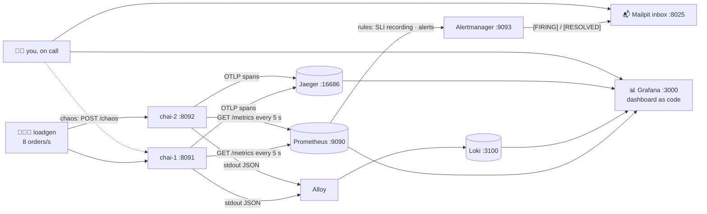

# 🏁 Project 2: See Everything: Monitoring and Observability (Lab Exercise 8)

> **Syllabus lab exercise 8:** *Configure Prometheus monitoring, Alertmanager alerts and Grafana dashboards for application observability.*
>
> ⏱ 2–3 hours · 🟡→🔴 · Needs: Docker + Compose, ~2 GB free memory, ports 3000 / 9090 / 9093 / 8025 / 16686 / 3100 / 8091 / 8092 free. Best after labs [C06](../../C06-prometheus/README.md) to [C09](../../C09-slo-incident-response/README.md).
>
> **After every phase run `./scripts/verify.sh N`**: ✔ or ✖ with a hint.

## 🎯 The mission
The Chai Stall is live and busy. Nobody is watching it. Last Friday it served errors for 40 minutes and the first sign was an angry customer. **Build the platform that tells you first**: metrics, a dashboard, alerts that email the on-call, logs you can search, traces you can follow. Then **break the stall on purpose**, get paged, find the cause with all three pillars, and write the postmortem.



You will have: a **Prometheus** that scrapes the app and computes **SLIs**, **tested alert rules**, an **Alertmanager** with grouping, routing, inhibition and **email**, a **Grafana dashboard stored as code**, **centralized logs** and **traces** with a clickable link between them, an **SLO with burn-rate alerts**, a **runbook**, and **your own postmortem**.

> 🧭 **No branches, no commits, no pushing needed here.** Prometheus, Grafana and Alertmanager read the files in *this folder* directly, so an edit takes effect as soon as you save it (and reload where the lab says so). Git only helps you *see* what you changed (`git diff`). Nothing in this project touches the shared repository.

## 📋 The phases

| # | Phase | You prove | Time | Lab |
|---|---|---|---|---|
| 0 | Pre-flight | your machine is ready | 5 m | |
| 1 | Boot the platform | all targets are UP | 10 m | [C06](../../C06-prometheus/README.md) |
| 2 | **Metrics**: find the four golden signals | you can query them | 25 m | [C06](../../C06-prometheus/README.md) |
| 3 | **Dashboard as code** | you added a panel through Git | 15 m | [C07](../../C07-alerting-grafana/README.md) |
| 4 | **Logs and traces** | you jumped from a log to a trace | 20 m | [C08](../../C08-logs-and-traces/README.md) |
| 5 | **Write an alert** (and test it) | your rule is tested, loaded and fires | 25 m | [C07](../../C07-alerting-grafana/README.md) |
| 6 | **Game day**: three incidents + a postmortem | detection, triage, mitigation | 45 m | [C09](../../C09-slo-incident-response/README.md) |
| 7 | **Watch Project 1's releases** | a canary visible on your dashboard | 20 m | [C05](../../C05-images-and-deployment/README.md) |
| 8 | Clean up | | 5 m | |

---

## Phase 0: Pre-flight (5 min)
```bash
./cicd-observability/scripts/doctor.sh
cd cicd-observability/projects/project-2-see-everything
```
Tight on memory? Project 1 and Project 2 together want ~4 GB. Stop Project 1's stack first if you are not using it (`docker compose stop` there).

## Phase 1: Boot the platform (10 min)
```bash
docker compose up -d --build
docker compose ps                 # ten services; chai-1, chai-2 and mailpit show "healthy"
./scripts/verify.sh 1
```
Open the six doors and keep them in tabs:

| Tab | URL | Login |
|---|---|---|
| 📊 Grafana | http://localhost:3000 | `admin` / `z2h-grafana` |
| 📈 Prometheus | http://localhost:9090 | none |
| 🔔 Alertmanager | http://localhost:9093 | none |
| 📬 **Inbox** | http://localhost:8025 | none |
| 🧵 Jaeger | http://localhost:16686 | none |
| ☕ the app | http://localhost:8091 | none (click *Order chai*) |

In Prometheus open **Status → Targets**: all green. In Grafana open **Dashboards → Chai Stall: Service Overview**: live traffic.

## Phase 2: Metrics: the four golden signals (25 min)
Prometheus → **Graph**. For each signal, **write the query yourself first**, then check. (C06 has the PromQL ladder if you need it.)

| Signal | Question | Your query |
|---|---|---|
| **Traffic** | requests per second, all instances | ? |
| **Errors** | share of `/order` requests returning 5xx | ? |
| **Latency** | p95 duration of `/order` | ? |
| **Saturation** | requests being handled right now, per instance | ? |

<details><summary>Check your queries</summary>

```
Traffic     sum(rate(http_requests_total{job="chai-stall"}[1m]))
Errors      sli:order_errors:ratio_rate5m
            (or by hand:  sum(rate(http_requests_total{path="/order",status=~"5.."}[5m])) / sum(rate(http_requests_total{path="/order"}[5m])) )
Latency     histogram_quantile(0.95, sum by (le) (rate(http_request_duration_seconds_bucket{path="/order"}[1m])))
Saturation  sum by (instance_name) (http_requests_in_flight)
```
</details>

Then three **business questions** (a non-technical manager would ask these; metrics can answer them):
1. Which menu item sells best right now?
2. How many orders were placed in the last 10 minutes?
3. Is one instance serving more than the other?

<details><summary>Check</summary>

```
1  topk(1, sum by (item) (rate(orders_total[5m])))
2  sum(increase(orders_total[10m]))
3  sum by (instance_name) (rate(http_requests_total{path="/order"}[1m]))
```
</details>

Finally, **prove up works**: `docker compose stop chai-2`, watch `up{job="chai-stall"}` fall to 0 for it, then `docker compose start chai-2`.
```bash
./scripts/verify.sh 2
```

## Phase 3: Dashboard as code (15 min)
Dashboards in Git, reviewed like code. The file is [`grafana/dashboards/chai-stall.json`](grafana/dashboards/chai-stall.json); Grafana reloads it by itself.

1. **Read** the dashboard top to bottom and match every panel to a golden signal or to the SLO (C07, Step 5).
2. **Add a panel with the helper**, then look at what changed in Git:
```bash
./scripts/add-panel.py "Orders per minute" 'sum(increase(orders_total[1m]))'
git diff --stat grafana/dashboards/chai-stall.json
```
Wait ~20 seconds and refresh the dashboard: a new panel at the bottom. That is a dashboard change that went through `git diff`, and could go through a pull request.
3. **Your turn**: add a second panel that answers one of the business questions from Phase 2 (`topk`, per-instance traffic, a ratio…). Use `./scripts/add-panel.py "<title>" '<promql>' [unit]`. Units: `short`, `percentunit`, `s`, `reqps`, `ops`.
4. **Stretch**: open the dashboard JSON in Grafana (**Dashboard settings → JSON Model**), change something in the UI *there*, and notice you cannot save a provisioned dashboard from the UI. Why is that a feature? *(The file is the truth; click-edits would drift from Git.)*
```bash
./scripts/verify.sh 5
```

## Phase 4: Logs and traces (20 min)
Follow [C08](../../C08-logs-and-traces/README.md) Steps 2 to 5. The deliverable is a **three-click trace**: start from the dashboard's *Order error ratio* graph while errors are on (`for p in 8091 8092; do curl -s -X POST "localhost:$p/chaos?error_rate=0.3"; done`), open **Explore → Loki** with `{service=~"chai-.*"} | json | level="error"`, expand a line, click its **trace_id** link, and read the trace in Jaeger. Then `…/chaos/reset`.

Write down, in one sentence each: *what did the metric tell you? what did the log tell you? what did the trace tell you?*
```bash
./scripts/verify.sh 3
./scripts/verify.sh 4
```

## Phase 5: Write an alert, and test it (25 min)
The stall has an availability SLO (99% of orders succeed) with burn-rate alerts. It also has a **latency SLO** (95% of orders finish within 250 ms) and **nothing alerts when it is missed**. Fix that.

**Your task:** write the alert **`OrderLatencySLOBreach`**: it must fire when **less than 90%** of orders are faster than 250 ms, sustained for **30 seconds**; severity `warning`, team `stall`; with a summary, a description and a runbook link (`docs/runbook.md#slow-orders`). The SLI already exists as a recording rule: `sli:order_latency_good:ratio_rate5m`.

Work in this order (it is how professionals do it):
1. **Write the rule** in [`prometheus/rules/alerts.yml`](prometheus/rules/alerts.yml) (put it in the `chai-stall-slo` group).
2. **Check the syntax:**
   ```bash
   docker run --rm -v "$PWD":/w -w /w --entrypoint promtool prom/prometheus:v3.5.0 check rules prometheus/rules/alerts.yml
   ```
3. **Write a unit test** in [`tests/rules_test.yml`](tests/rules_test.yml): feed fake data where 70% of requests are slow, assert the alert fires. (Look at the existing tests as templates.)
4. **Run the tests:** `docker run --rm -v "$PWD":/w -w /w --entrypoint promtool prom/prometheus:v3.5.0 test rules tests/rules_test.yml`
5. **Load it without a restart:** `curl -X POST localhost:9090/-/reload`, then check **Alerts** in Prometheus: *inactive*.
6. **Make it fire for real:** `for p in 8091 8092; do curl -s -X POST "localhost:$p/chaos?latency_ms=700"; done`. It should go *pending* then *firing* in about 75 seconds, and an email should arrive.
7. `for p in 8091 8092; do curl -s -X POST "localhost:$p/chaos/reset"; done` and wait for `[RESOLVED]`.

<details><summary>Hint 1: the rule</summary>

```yaml
      - alert: OrderLatencySLOBreach
        expr: sli:order_latency_good:ratio_rate5m < 0.90
        for: 30s
        labels: { severity: warning, team: stall }
        annotations:
          summary: "Only {{ $value | humanizePercentage }} of orders are faster than 250 ms (SLO: 95%)"
          description: "The latency SLO is being missed. Runbook: docs/runbook.md#slow-orders"
```
</details>

<details><summary>Hint 2: the test</summary>

A counter that increases by 30 per step in total, of which only 9 land in the fast bucket (30% fast, 70% slow):
```yaml
  - name: a slow stall misses the latency SLO
    interval: 15s
    input_series:
      - series: 'http_request_duration_seconds_bucket{job="chai-stall",path="/order",le="0.25"}'
        values: '0+9x40'
      - series: 'http_request_duration_seconds_count{job="chai-stall",path="/order"}'
        values: '0+30x40'
    alert_rule_test:
      - eval_time: 9m
        alertname: OrderLatencySLOBreach
        exp_alerts:
          - exp_labels: { severity: warning, team: stall }
            exp_annotations:
              summary: "Only 30% of orders are faster than 250 ms (SLO: 95%)"
              description: "The latency SLO is being missed. Runbook: docs/runbook.md#slow-orders"
```
Run the tests: if `promtool` complains about an annotation, it prints the exact text it expected: copy it.
</details>

Make the **dashboard** show it too if you like (an *SLO: latency* panel with `sli:order_latency_good:ratio_rate5m`, via `add-panel.py`). 🎓 *Optional:* add the alert to the C07 `.github/workflows` check by pushing your fork: the pipeline now guards your alert.

## Phase 6: 🔥 Game day: three incidents and a postmortem (45 min)
Do the game day exactly as written in [**C09, Step 4**](../../C09-slo-incident-response/README.md): **Incident 1 "Orders are failing"** (`error_rate=0.5`), **Incident 2 "Customers are waiting"** (`latency_ms=700`), **Incident 3 "An instance is gone"** (`docker compose stop chai-2`). For each one, keep the timeline table and use the [**runbook**](docs/runbook.md) as the on-call.

Then write the postmortem for Incident 1 from [`docs/postmortem-template.md`](docs/postmortem-template.md): **summary, impact (budget burned), timeline, root cause (five whys), what went well/badly, and at least three action items with owners and dates**.
```bash
./scripts/verify.sh 6              # a [FIRING] email arrived, and a [RESOLVED] one followed
```

> **Self-review question:** your Phase 5 alert should have joined Incident 2. Did it page earlier than `ChaiStallHighLatency`? If not, what would you change (the `for`, the threshold, the window)?

## Phase 7: Watch Project 1's releases (20 min)
Now join the two projects: deploy with Project 1's pipeline and **watch it on this dashboard**.

1. **Project 1 must be running with *both* colours deployed.** If it is not: in `../project-1-ship-it` run `docker compose up -d`, build two quick demo versions as in C05 Step 2 (`demo-1`, `demo-2`), then deploy them one after the other so that **blue and green both exist**:
   ```bash
   R=localhost:5001/chai-stall
   ./deploy/deploy.sh bluegreen $R:demo-1
   ./deploy/deploy.sh bluegreen $R:demo-2
   ```
   (If you finished Project 1's Phase 5 you already have both. A missing colour would show as DOWN here, and rightly raise an alert.)
2. **Attach this Prometheus to Project 1's network** and tell it where to look:
   ```bash
   cd ../project-2-see-everything
   docker compose -f docker-compose.yml -f docker-compose.shipit.yml up -d
   cp prometheus/targets/prod.yml.example prometheus/targets/prod.yml
   ```
   (Prometheus re-reads the targets file on its own.) After ~30 seconds, **Status → Targets** shows `chai-blue` and `chai-green` as part of the `chai-stall` job, and the dashboard's *Instances up* counts them (4 instead of 2). Their logs flow to Loki too: `{service=~"chai-(blue|green)"}`.
3. **Make traffic** on production, in a terminal you leave open:
   ```bash
   while true; do curl -s -o /dev/null -X POST localhost:8090/order; sleep 0.1; done
   ```
4. **Release a buggy canary** from the Project 1 folder, while you watch the dashboard (set the refresh to 5 s and the range to 5 minutes):
   ```bash
   cd ../project-1-ship-it
   CHAOS_ERROR_RATE=0.3 ./deploy/deploy.sh canary localhost:5001/chai-stall:demo-2 40
   ```
   Within a minute: **"Version running"** shows **two versions**; **errors per status** gets a `500` line; the **error ratio** climbs to roughly 10%; **only the canary's instance** has 5xx (`sum by (instance_name) (rate(http_requests_total{status=~"5.."}[1m]))`); the **Recent errors** panel fills with lines from `chai-green` (or `chai-blue`: whichever is the canary). If the error stays high long enough, the burn-rate alert emails you too.
5. **Roll back**: `./deploy/deploy.sh rollback`. Watch the error ratio fall. Now you see *the same canary decision* that `canary-check.sh` makes automatically, as a graph a human can read.
6. Stop the traffic loop (Ctrl+C).

**Reflect:** the pipeline's canary check took about 30 seconds and *judged the canary alone*. The dashboard shows the *blended* error ratio, which is much smaller (the canary got only 40% of traffic). Which one would you page on? Which one would you roll back on? *(Roll back on the canary's own error rate; page on the user-visible SLO burn.)*

## Phase 8: Clean up (5 min)
```bash
cd ../project-2-see-everything
docker compose -f docker-compose.yml -f docker-compose.shipit.yml down -v 2>/dev/null || docker compose down -v
echo '[]' > prometheus/targets/prod.yml            # put the empty targets file back
```
`git status` shows the files *you* changed on purpose. To undo any of them (a dashboard or rule you edited), use `git restore <file>`; to keep your work, you may `git commit` on a private branch (`git switch -c my-observability`): committing only ever stays on your laptop.

---

## ✅ Definition of done
- [ ] All targets UP; I can write the four golden-signal queries from memory
- [ ] My dashboard change went through `git diff`
- [ ] I followed one failing request: **metric → log line → trace**
- [ ] I wrote an alert, **unit-tested** it with promtool, loaded it, and watched it fire and resolve
- [ ] I received `[FIRING]` and `[RESOLVED]` emails for three different incidents
- [ ] I can say, for each incident, **which SLO it burned**, time to detect and time to mitigate
- [ ] I wrote a postmortem with actions, owners and dates
- [ ] I watched a canary release on the dashboard and could say why the pipeline and the dashboard disagree about the error rate
- [ ] `./scripts/verify.sh` prints all ✔

## 🧯 Troubleshooting
| Symptom | Cause and fix |
|---|---|
| A container keeps restarting | `docker compose logs <service> \| tail -20` shows why; the most common cause is a **port already in use** (run `doctor.sh`) |
| Grafana shows "No data" | give it a minute; check Prometheus **Targets**; then `docker compose ps loadgen` (no traffic = no data) |
| Dashboard panel "Order error ratio" is empty | nothing failing, no errors recorded: the rule uses `or vector(0)`, wait 30 s for the rule to evaluate |
| No Loki logs | `docker compose logs alloy \| tail`; on **Docker Desktop for Windows (WSL2)** make sure the Docker socket is shared; the app services must carry `logging: "true"` |
| Loki query: `pipeline error: JSONParserErr` | a malformed line is in range: add `\| __error__=""` after `\| json` |
| No trace in Jaeger | `docker compose logs chai-1 \| head`: is `OTEL_EXPORTER_OTLP_ENDPOINT` set? give it a minute |
| No alert email | Prometheus **Alerts** (firing?) → Alertmanager (:9093: received? silenced?) → `docker compose logs alertmanager \| tail`. Allow ~40 s after the alert fires |
| An alert I wrote does not load | `promtool check rules` prints the line; remember YAML indentation |
| `verify.sh 6` says no `[RESOLVED]` | wait ~2 minutes after `chaos/reset` (the alert's windows must drain); the 30-minute slow-burn alert may also still be firing: that is expected, see C09 |
| Phase 7: `network shipit not found` | Project 1's stack has not been started (it creates the network): `cd ../project-1-ship-it && docker compose up -d` |
| Start over | `docker compose down -v && docker compose up -d --build` |

## 💼 For your CV / portfolio
> *Built an observability platform with Prometheus, Alertmanager, Grafana, Loki and Jaeger around a live service: RED/golden-signal dashboards as code, SLI recording rules and multi-window burn-rate alerts, unit-tested alert rules in CI, structured JSON logging with trace correlation, runbooks and blameless postmortems from simulated incidents.*

Add a screenshot of the dashboard during an incident (see [`images/dashboard-incident.png`](images/dashboard-incident.png) for the kind of thing to capture), your postmortem, and your alert rule + test.

➡️ Back to the [track overview](../../README.md) · ☸️ the same ideas in Kubernetes: [K19](../../../kubernetes/19-observability/README.md), [K20](../../../kubernetes/20-projects/README.md)
